# Architecture

How the engine is built today, through Phase 9.23: real lights and emissive surfaces with soft ray-traced shadows, sampled by ReSTIR DI over a G-buffer, indirect light from a bounce lit by the lights and a radiance cache, ray-traced reflections and glass, their denoiser, temporal antialiasing that upscales from a resolution that moves to hold the frame rate, the image formed by an adapting eye, bloom and AgX for SDR and HDR10 displays, a sky, PBR materials, normal maps and particles on the GPU, whose effects are files, with ribbons and mesh particles. [OVERVIEW.md](../OVERVIEW.md) holds the vision and the roadmap, and [the ADRs](adr/README.md) hold the reasons for each decision. This page describes what the code does now, and it changes in the same pull request as the code.

## Modules

Each module is a static library in `engine/<module>/`. A module exists only if it is a real layer, or if it hides a large third-party library (ADR-0021). An arrow means "links to". The graph comes from the `CMakeLists.txt` files, and it has no cycles.

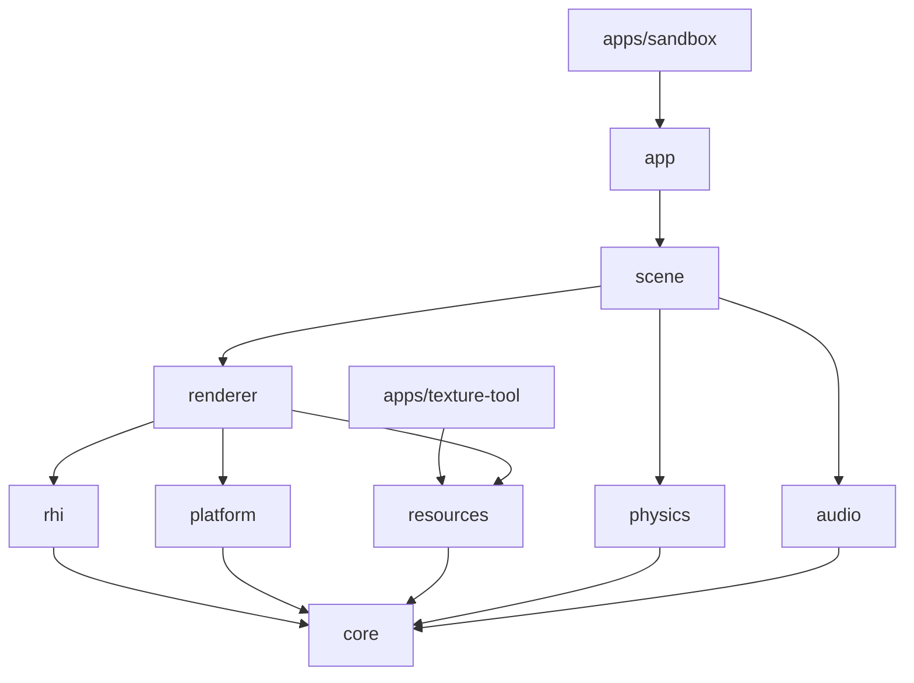

Every module also links to `core`; the graph only shows it for the bottom row.

| Module | Responsibility | Third-party libraries it hides |
|---|---|---|
| `core` | `Result`, `Error`, `DAI_ASSERT`, `DAI_TRY`, handles, slot pool, frame timer, worker pool, cvars, profiling macros, logging (`logging::`), conventions, transforms, projections and boxes (`math::`) | spdlog; GLM, tl::expected and Tracy are public on purpose |
| `platform` | Window, events, Vulkan surface, processes, crash dumps, and keyboard, mouse and gamepad state with actions (`input::`) | SDL3 |
| `resources` | Asset paths, caches, decoding of files into plain CPU data, and encoding of KTX2 textures for `texture-tool`, which also makes flipbooks (ADR-0046, ADR-0053) | fastgltf, KTX, stb |
| `rhi` | Vulkan 1.4 device with ray queries, swapchain, buffers, textures, pipelines, command lists, batched uploads | Vulkan, volk, VMA |
| `renderer` | Draws a `SceneView`: G-buffer, lighting, skinning, materials, shader hot reload, the game's interface (`ui::`), and the debug overlay (`debugui::`, development builds) | Dear ImGui, stb_truetype (in `resources`) |
| `physics` | Collisions, characters and ray queries of a scene | Jolt |
| `audio` | Output, mixing, clips and voices of a scene, silent without an output | miniaudio, stb_vorbis |
| `scene` | Entities (`ecs::`), animation (`animation::`), the asset library, the engine's components, the systems that tie entities to the renderer, physics and sounds, and the scene itself | |
| `app` | Startup and shutdown in order, main loop, current scene, the player's settings, the developer console and tools (development builds) | |

Headers are included by namespace, not by module: `<daidalos/math/Transform.hpp>` lives in `core`, and `<daidalos/ecs/World.hpp>` in `scene`.

Three rules keep this graph healthy:

- **Only `scene` knows about entities.** The renderer draws a `SceneView` of copies, and physics and audio know bodies and voices. `scene::ExtractScene`, `SyncKinematicBodies` and `SyncSoundEmitters` connect them to the ECS.
- **Nothing above `rhi` knows about Vulkan.** `rhi` hides it completely, with concrete classes and no virtual interface (ADR-0007). It does not depend on `platform`: it receives a callback that creates the surface, so it can run with no window, which the GPU tests rely on.
- **`resources` does not depend on `rhi`.** It produces plain CPU data, and `scene::AssetLibrary` turns that into GPU objects through the renderer (ADR-0016).

## Startup and shutdown

`app::Application::Start` starts each step in order. If a step fails, `Stop` releases whatever is started, in reverse order, so nothing runs half-initialized. A normal shutdown calls the same `Stop`.

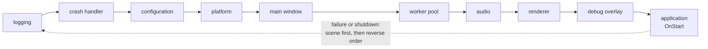

The configuration step reads the engine's settings from `daidalos.cfg` next to the executable, then the files a game adds, such as `sandbox.cfg`, then the player's own `user.cfg`, then the command line; later ones win (ADR-0026). The build copies `config/daidalos.cfg` next to every application the first time. Settings that the renderer and the audio can follow while running, such as antialiasing, the field of view and the volumes, are applied every frame; the others are read at startup. A game's options change settings with `Application::ChangeSetting`, and `Application::SaveSettings` writes them to `user.cfg`: the ones it held and the ones changed, never values that only came from the command line (ADR-0029). A quality preset (`renderer.quality`: low, medium, high or ultra) decides eleven rendering settings, from the render scale to the fog's cells; each follows it until something sets it, which the options show as Custom (ADR-0052). At the first launch, `auto` draws the first level at High, times 120 frames on the GPU and keeps the best preset that holds the target frame rate with a margin. The device reads its pipeline cache from `pipelines.cache` next to the executable, unless another GPU or driver wrote it, and writes it back at shutdown. After the first frame that draws a level, pipeline creation is locked: a pipeline created later is logged as an error, as it would stall a frame. Video memory in use and the budget come from `VK_EXT_memory_budget` when the device has it.

The game plugs in through `app::IApplicationHandler`: `OnStart`, `OnEvent`, `OnFixedUpdate`, `OnUpdate`, `OnRender` and `OnStop`. It usually gives the application a `scene::Scene`, which the application then runs. `Stop` releases the scene before anything else, because its assets and sounds belong to the renderer and the audio engine, even if `OnStart` failed halfway. A machine with no audio output only gets a warning, and its scenes stay silent (ADR-0019).

## One frame

Everything here runs on the main thread, except the jobs of the worker pool (ADR-0011). The GPU runs in parallel, with up to two frames in flight.

```mermaid
sequenceDiagram
    participant A as Application
    participant G as Game handler
    participant S as Current scene
    participant R as Renderer
    participant D as rhi::Device

    A->>A: Swap in the pending scene
    A->>A: Read events, update InputState
    A->>G: OnEvent, for each event
    A->>A: Deliver finished worker jobs
    A->>A: Advance the frame timer
    loop 0 to n fixed steps
        A->>G: OnFixedUpdate
        A->>S: Fixed systems, then physics
    end
    A->>G: OnUpdate
    A->>S: Frame systems, then animators
    A->>S: Extract: transforms, SceneView with current and previous matrices, particle spawns, ribbons, sounds and listener
    A->>G: OnRender
    A->>R: Render(SceneView, overlay)
    R->>R: Reload changed shaders
    R->>D: BeginFrame: send the pending uploads, read last timestamps
    R->>D: Skinning, with the previous joints too, then the frame's acceleration structures
    R->>D: Emissive lights: new emissive meshes averaged once, the frame's emissive triangles placed (compute)
    R->>D: Particles: emit, simulate, sort with the ribbons' segments (compute)
    R->>D: G-buffer, jittered, at the render resolution in the targets' corner: depth, normals, motion vectors, base color, emission; mesh particles too
    R->>D: Radiance cache: update, resolve; indirect light: one ray per pixel, its hit lit by the lights (compute)
    R->>D: Reflections: one ray per pixel along its specular lobe (compute)
    R->>D: Direct lighting: ReSTIR DI, then one shadow ray per pixel, plus indirect light and reflections (compute)
    R->>D: Volumetric fog: each froxel lit by one light and one shadow ray, then added up from the camera (compute)
    R->>D: Denoiser: the light averaged over frames, then over neighbours (compute)
    R->>D: Composite: the light put back together, the sky, seen through the fog, into the HDR target
    R->>D: Particles and ribbons drawn back to front, one indirect draw, and their coverage as a reactive mask
    R->>D: Glass, if any: the frame copied, then glass drawn over it, reading the copy and tracing rays
    R->>D: Temporal resolve: the frame upscaled to the output and blended with the reprojected history (compute)
    R->>D: Exposure histogram and bloom (compute); interface and overlay into their layer
    R->>D: Output: sharpening, exposure, bloom, AgX and the interface layer, into the back buffer as sRGB or HDR10
    R->>D: EndFrame: submit and present
```

`SceneView` holds copies, so rendering never touches the ECS. World transforms are recomputed from scratch every frame, during extraction, with no dirty flags (ADR-0006).

## From file to GPU

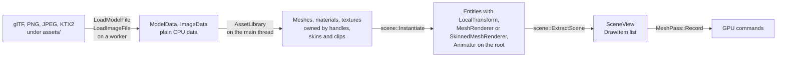

An asset's identity is its normalized path relative to the asset root. The case must match the file on disk, so a mismatch fails on Windows as well as on Linux. A shared texture is uploaded once. `LoadModel` does all of this at once, and `LoadModelAsync` keeps the main thread running during the first arrow. The uploads of the second arrow are only recorded: they reach the GPU together, ahead of the next frame, and nothing waits for them. Loading a replacement level happens in a second scene, which takes over when it is ready.

The sandbox's level comes from the legacy engine, through `scripts/import_legacy_level.py`: a single glTF file, whose node names tell the game what each node is (ADR-0017). Animated models have their own glTF files, which the level points to with `model=` in a node's name.

## Animation

Joints are entities, so animation only writes transforms, and everything else is the usual path (ADR-0020).

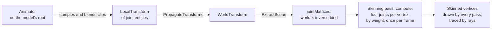

## Who owns what

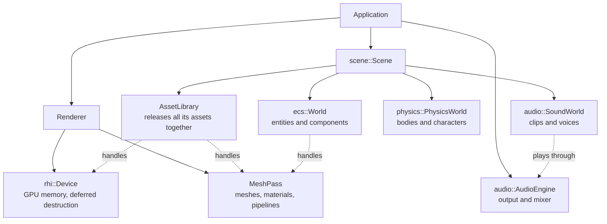

Solid arrows own, and dotted arrows only refer. GPU objects are never held by pointer outside their owner. Everyone else holds a generational handle, which detects when its slot was freed or reused:

- A draw with a destroyed mesh is skipped, and a draw with a destroyed material uses the default one, so unloading assets before entities is safe.
- `Destroy*` invalidates the handle at once. The GPU object is released when the timeline semaphore shows that the GPU has finished with it.
- The renderer must outlive every `AssetLibrary`, which `Application::Stop` guarantees by releasing the scene first. There is no reference counting and no eviction (ADR-0016).

## How the GPU reads its data

The renderer uses bindless access: one descriptor set holds every texture, cube texture, storage buffer, storage image and top-level acceleration structure, and each draw only pushes indices. A ray's hit finds its draw's InstanceData by its custom index.

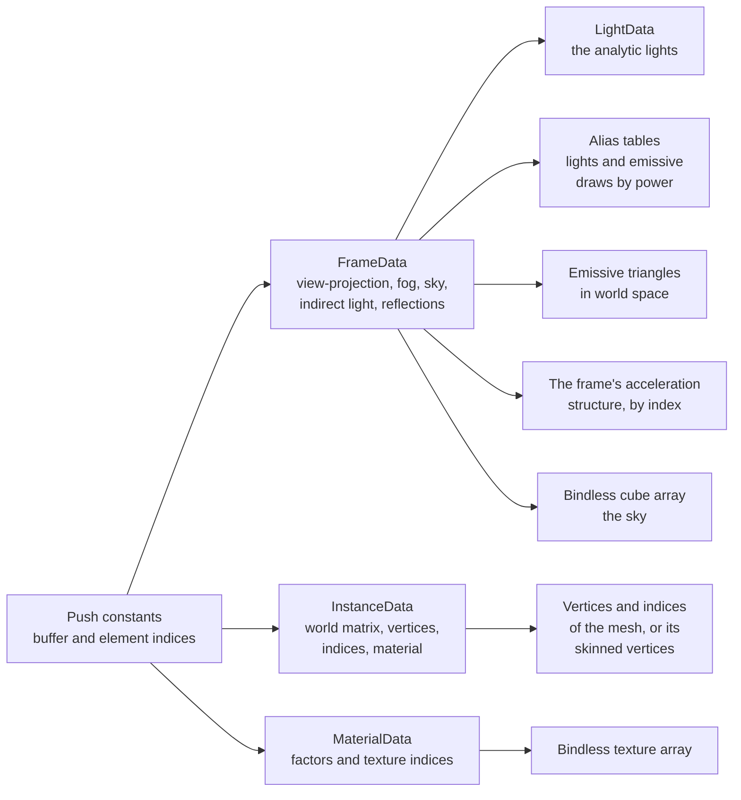

## Lighting

Meshes are shaded in linear HDR with metallic-roughness PBR, the frame's lights and the light that bounces between surfaces, then tonemapped (ADR-0022, ADR-0040). Lights are `scene::Light` entities: point, spot or directional. Spot and directional lights shine down their entity's local -Z, so a lamp is placed and turned like anything else, and a light parented to the camera follows it. A directional light, such as the factory's moon, is infinitely far and has an angular radius instead of a radius. Levels bring their lights in glTF's `KHR_lights_punctual`, which become `scene::Light`s on their nodes' entities.

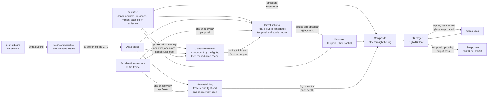

Light is in physical units (ADR-0043): point and spot lights in candela, directional lights in lux, with a tint and an optional color temperature in kelvin; emission and the sky in nits. A light falls off with the inverse square of the distance, faded to zero at its range by a smooth window, and shading is the illuminance times the BSDF. The scene sets its exposure in EV100 (the factory's is 3, a dim interior), or a range the eye adapts within (see below), and the player adds stops to it. Lights, emission and the sky reach the GPU already multiplied by an exposure fixed for the level, so the targets, the cache and the denoiser hold values near the screen's. Normal maps follow glTF (green up, bitangent from the tangent's `w`), and meshes that lack tangents get MikkTSpace ones at load. Lighting is deferred (ADR-0044): one raster pass, the G-buffer, writes each pixel's depth, normal and roughness, motion, base color and metalness, emission and occlusion, and compute passes light it. Lamps and the triangles of emissive meshes are lights alike: an emissive material lights the scene unless its glTF extras say `{"light": false}`. Each frame, the CPU builds an alias table that draws lights by power, and each emissive draw has one of its own over its triangles, whose emission a compute pass averages from the texture once. ReSTIR DI (Bitterli et al. 2020) then gives each pixel one light: eight candidates drawn by power and weighed by what they would send, one kept and tested for shadows, combined with what the same surface kept last frame and with three neighbours on the same surface, and one shadow ray towards it. Whatever the number of lights, a pixel casts one shadow ray; lights keep their names from frame to frame, so a pixel's choice follows its light, and each is flagged when it is new or moved since the last frame: where a pixel's light moved, as the flashlight with the camera, the denoiser keeps 4 frames of history instead of 32, and the fog less of its own (ADR-0051). `renderer.debug_view lights` shows each pixel's light. No light comes from nowhere: what no light reaches, directly or after bouncing, is black. Indirect light comes from a radiance cache, a hash grid of world space whose cells hold the light surfaces send (ADR-0040). Each frame, one path from the camera per 4×4 pixels adds to the cells of the surfaces it meets the light of one light, picked among eight, and what it brings back from farther. Its last ray reads the cache, so light bounces on frame after frame. Then each pixel casts one ray, in a random direction around its normal (ADR-0045). Where it hits, the surface is lit by one of the lights, picked among four, with a shadow ray, and reflects what one more ray reads from the cache; where it leaves, the sky shows. The bounce has the shadows and detail the cache's cells miss, and follows a moving light, a flashlight, at once. `renderer.gi_bounces` lights more surfaces before the cache is read, or none, and `renderer.gi_rays` casts more rays per pixel. Bounced light is clamped in luminance (`renderer.gi_clamp`), so that a lamp against a wall does not spread fireflies; direct light never is. Cells are kept apart by the orientation of their surface, and by an anchor that a point behind a wall cannot see: light does not leak through walls. Each pixel also casts a ray along its specular lobe (ADR-0042), drawn from the GGX distribution of its roughness: on smooth surfaces it shades what it hits, a mirror reflecting on up to three surfaces; on rougher ones it reads the cache where it hits, and fills cells no other path goes to; above `renderer.reflection_roughness` (0.6), no ray is cast and the indirect light stands in. The lighting multiplies what came back by the specular albedo. A sharp reflection shows emissive lights, whose specular light light sampling then leaves out, so each light is counted once. Glass (`KHR_materials_transmission`, with its IOR and volume) is left out of the G-buffer: after particles, the frame is copied, and the glass pass draws glass over it, testing the G-buffer's depth itself. A pixel of glass is its reflection, as much as Fresnel says, plus what goes through, tinted: the frame behind it for thin glass; for thick glass, a ray bent in, across to the far side and bent out, absorbed on the way. What those rays find is read from the frame when it is on screen, and shaded otherwise. Glass casts no shadow, and only the glass pass and the path tracer see it. Every light casts shadows: the shadow ray goes against the frame's acceleration structure, and alpha-tested surfaces let light through their holes (ADR-0035). A light is a sphere, 5 cm across by default for `scene::Light`: each frame, the ray aims at another point of it, so shadows are soft and noisy at their edges. The lighting writes the diffuse and specular light apart from the emission, without the surface's colors, and the denoiser averages them with their history where the surface is the same as last frame, then with neighbours on the same surface, as much as their noise asks: light that is not noisy, such as a hard shadow, goes through unchanged. On smooth surfaces, the specular history is found where the reflected point was, from the reflection's hit distance. A composite pass multiplies the colors back in (ADR-0039), seen through the fog in front of them. Fog is a participating medium lit by the lights (ADR-0051): the level's, the same everywhere within the view distance, with a density, an albedo and an anisotropy, and boxes of fog (`scene::FogVolume`) that add their density, thinning at their faces, with a noise that drifts; a box with a falloff height lies on the ground, densest on the floor and halving going up. The factory places its boxes as glTF nodes named `fog;...`, as its lamps. A grid of froxels follows the camera, 16 pixels of the output across and 64 slices deep, spaced exponentially to the far plane, in 3D textures. Each frame, a point in each froxel takes the light of one of the frame's lights, chosen among eight drawn with even odds by power or by power near the camera, a second alias table where the flashlight weighs as much as it shows, with one shadow ray, blended with what the froxel held last frame where it was, or at the nearest edge of last frame's view; a second pass adds the froxels up from the camera. The composite, glass and particles read the fog at their depth, each pixel half a froxel off a different way each frame, which temporal antialiasing averages. Light that reaches surfaces loses what the level's fog takes on the way; boxes of fog shadow nothing. The path tracer crosses the same fog by delta tracking. `renderer.debug_view fog` shows the fog alone. Where nothing is drawn, it shows the level's sky, a cube texture (ADR-0036). Nothing beyond the view distance is drawn: the projection has a far plane there. Edges are smoothed by temporal antialiasing (ADR-0037): each frame moves the camera by a fraction of a pixel, the G-buffer writes where each pixel's surface was in the previous frame, from the previous matrices that `ExtractScene` keeps per entity, and a compute pass blends the frame with the history of the earlier ones, clipped towards the colors around each pixel. Particles mark what they cover, where the history counts less, and a teleport or a new scene starts the history over. Draws can opt out, as the sandbox's weapons do. Everything up to the glass is drawn at a render resolution below the window's, and the resolve upscales it (ADR-0049): each output pixel takes the frame's sample that landed nearest to it, weighted by how near, the jitter's cycle growing as the scale falls (8 / scale² positions), and textures are sampled with a mip bias of log2 of the scale, so that the output's detail builds up over frames; the output pass sharpens the result as FSR's RCAS does (`renderer.sharpness`). `renderer.upscaler fsr` upscales with AMD FSR 3.1 instead (ADR-0050): AMD's compute passes, unchanged in `third_party/fidelityfx-fsr3`, read and write through callbacks that the engine implements over its bindless arrays, and run in the render graph like the engine's own; it is steadier, a little less accurate and costs more. The targets keep the window's size and the frame draws into their top-left corner, so a change of scale reallocates nothing, and the passes that look back find last frame's pixel with last frame's size. Dynamic resolution moves the scale between `renderer.min_render_scale` and `renderer.render_scale` to hold `renderer.target_fps` on the GPU, from timings read back two frames late: down at once to what the budget allows, up by a step after half a second well under it. Without antialiasing, and in debug views, the scene renders at the window's size. Each group of passes is timed with GPU timestamps, which `Renderer::GpuTimes` returns and the developer tools show.

`MeshPass` keeps one frame slot per frame in flight, so the CPU never writes data the GPU is still reading. Shaders are written in Slang, compiled to SPIR-V by `slangc` during the build and embedded in the binary. In development builds, the sources are watched and recompiled by the `slangc` executable (ADR-0031).

## Forming the image

The output pass turns the frame's light into what the display shows (ADR-0048).

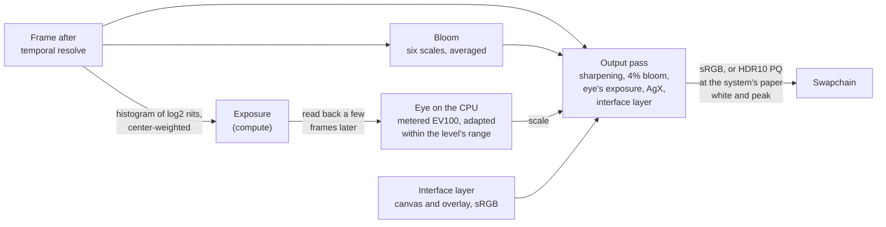

Auto-exposure is an eye: it closes fast in bright light (0.5 s) and opens slowly in the dark (3 s), towards what a center-weighted histogram of the frame meters, between the 40th and the 95th percentile of its weight. It never leaves the range the level sets (`Atmosphere::ev100Min` and `ev100Max`): a horror level stays as dark as its author wants. The GPU's light is exposed once, at the middle of that range, and the eye and the player's brightness only scale the image in the output pass, so no temporal history goes stale when they change. Bloom has no threshold: six downsampled levels blurred back up, averaged, replace 4% of the image (`renderer.bloom`), so bright lights glow and nothing pops. AgX (`renderer.tonemap`) takes bright light towards white instead of clipping it to saturated colors. On a display with HDR turned on, the swapchain is HDR10, and the image is spread up to the display's peak above the paper white the system was calibrated to; elsewhere it is sRGB. The game's interface and the developer tools draw into a layer of their own, which the output pass lays over the image, so their pipelines do not depend on the display. On first start, the sandbox asks the player to set the brightness until a symbol is barely visible; its color comes from `DisplayTransform`, the output pass's functions on the CPU. `renderer.debug_view bloom` shows the bloom, and the developer tools show the eye's exposure and the histogram.

## The render graph

Each frame, the renderer and its passes add their passes to a `RenderGraph`, in the order they run (ADR-0032). A pass declares the textures and buffers it uses and, if it renders, its targets; the graph places the barriers between passes, wraps each in a debug label, and times each group of passes. It does not reorder passes or own resources.

```mermaid
flowchart LR
    SK["Skinning"] --> AS["Acceleration<br/>structures"] --> EL["Emissive<br/>lights"] --> SI["Simulation<br/>emit, simulate,<br/>finish, sort"] --> PP["G-buffer<br/>render resolution,<br/>mesh particles"] --> GI["Radiance cache<br/>update, resolve"] --> IL["Indirect light<br/>one ray per pixel"] --> ME["Direct lighting<br/>candidates, temporal,<br/>spatial, shading"] --> DN["Denoiser<br/>temporal, 5 spatial"] --> CO["Composite"] --> PA["Particles"] --> TR["Temporal resolve<br/>upscaled to the output<br/>(or FSR 3.1)"] --> EX["Exposure"] --> BL["Bloom<br/>6 down, 5 up"] --> UI["Interface"] --> OV["Overlay"] --> OU["Output"]
```

Barriers come from the RHI: each texture and buffer remembers its last write and the reads since, and `CommandList::Use` decides from that whether the next use must wait (`rhi::NextAccess`). The GPU tests run with synchronization validation, which reports any use that no barrier orders.

## Acceleration structures

Rays are traced against a top-level acceleration structure rebuilt every frame from the frame's draws (ADR-0033). Each mesh has a bottom-level structure, built once with its upload. Skinned draws are skinned once per frame by a compute pass, into world-space vertices that the G-buffer draws and that each skinned draw's own structure is refitted from, so rays and rasterization see the same surface. A ray's hit names its draw's entry in the frame's instance data, which holds its vertices, indices and material. `renderer.debug_view rays` shows the structure from the camera, one color per instance. `renderer.debug_view normals` shows the G-buffer's world normals, normal maps included, and `motion` its motion vectors.

## The reference path tracer

`renderer.debug_view path` replaces the lit scene with the reference path tracer (ADR-0034): a compute pass that traces one path per pixel per frame against the frame's acceleration structure and averages them while the view stays. It shades hits with the same materials, lights and BSDF as the lighting, and rays that leave the scene find the same sky; the BSDF lives in one Slang module, `Bsdf.slang`, that both import. It is what the ray-traced techniques of Phase 9 are compared with; it reflects off and goes through glass as Fresnel says. `sandbox.scene cornell` builds its test scene, the Cornell box, `sandbox.scene mirrors` the mirror room, of reflections and glass, and `sandbox.scene corridor` the dark corridor, lit only by the flashlight, of indirect light (ADR-0045).

## The game's interface

Games draw their HUD and menus on `Application::Canvas()`, a `ui::Canvas` begun again every frame (ADR-0027). It is immediate mode: rectangles, images and text are drawn in the order of the calls, in units of a screen 1080 high, and the game keeps its own state.

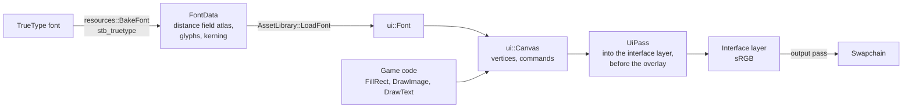

Fonts are baked into signed distance fields when they load, so text stays sharp at any size. The interface draws after antialiasing, so that the temporal history never holds text, into a layer under the debug overlay that the output pass lays over the image.

Menus use `ui::Context`, immediate mode too: buttons, toggles, sliders and choices draw themselves on the canvas and return whether the mouse or the keyboard used them, and the game keeps the values (ADR-0029). The context only remembers which widget has the focus, by its place in the frame. Behind a menu, `Scene::SetPaused` stops the scene's systems, physics, animations, particles and sounds, and the scene is still drawn as it was.

## Developer tools

Development builds have tools on top of the Dear ImGui overlay, opened with the key under Escape (ADR-0030). While they are open, the pointer is free and the game gets no keyboard or mouse input; the game itself keeps running.

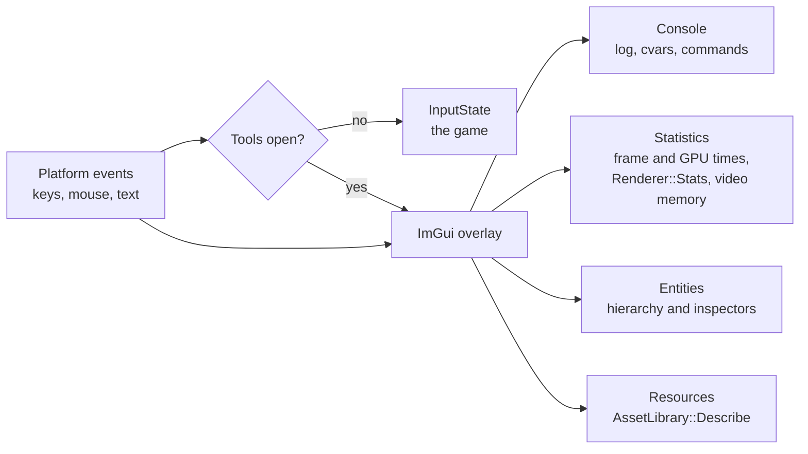

The console runs a command, shows a cvar, or sets one for this run; its log is a sink that keeps the last lines from every thread. Components have no reflection: each type the inspector shows has a small function that draws it, and games add their own components, windows and commands.

## Particles

Particles live on the GPU, in one pool of 65,536 (ADR-0025, ADR-0053). The CPU only sends the frame's spawn requests: `scene::ParticleEmitter` entities emit by their rate, by the meters they travel (spread along the way they went, carrying their velocity), and in bursts on a schedule, and `Scene::SpawnParticles` adds one-shot bursts.

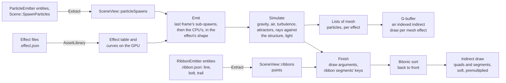

An effect is a JSON file (`.effect.json`, `scene::ParseParticleEffect`): its texture, relative to the file, a flipbook of cells of its grid with frames blended, color and opacity on a gradient over life, size, emission and speed on curves, how its quads turn (facing the camera, stretched along their velocity, turning around an axis, or lying in a plane), where particles appear (a box and sphere, a cylinder, a cone that opens out, a line), how they move, and how its emitters emit. Angles are in degrees there, and unknown keys are errors that name them. `AssetLibrary::LoadParticleEffect` loads a file once with its texture, and in development builds the scene reads changed files again twice a second, updating the effects in place and their emitters' emission. The renderer bakes each effect's curves into 256 samples in a buffer, which the passes read by life. Particles move in the air: gravity, then drag towards the air's velocity, the level's wind (`Atmosphere::wind`) and boxes of wind (`scene::WindVolume`) with gusts, then curl-noise turbulence and attractors (`scene::ParticleAttractor`), which can be kept to one effect. Colliding effects trace their motion of the frame against the frame's acceleration structure, glass included but not what casts no shadow, such as the weapons in the player's hands, and bounce, stick or die where they hit; a particle too slow to leave a surface slides, then rests. Impacts can spawn another effect the next frame, as can deaths: the simulation appends requests to one of two lists that swap each frame. Effects that report hits write them to the frame slot's buffer, which the CPU reads when the slot comes round again, with the count of particles alive: `Renderer::ParticleHits` gives each hit's effect and the material it hit, for decals and sounds. An effect can give its emitters a light (`EmitterLight`), which the scene adds to the frame's lights as bright as the emitter is active, flickering; a light whose brightness changes counts as moved for the denoiser. Lit particles scatter their light by a Henyey-Greenstein phase function, and flipbooks with six-way light maps are shaded with the direction of each particle's light. Distortion effects draw nothing but an offset into a third target, and a pass bends the frame by it before glass copies it. `texture-tool flipbook` makes fire, smoke and explosion flipbooks, with their six-way maps, from a small simulation it renders on the CPU. The sandbox's effects are in `assets/Factory/Effects/`, and the level's glTF nodes `particles;effect=<file>` name theirs. Effects can also be created from a `ParticleEffectDesc` in code, as tests do; `AssetLibrary::CreateParticleEffect` owns them with the level's other assets. Particles hide behind meshes and fade into them, lit ones take the light the simulation keeps for each of them: each particle keeps the light it chose, as ReSTIR does for pixels, tested for shadows, and additive ones glow in the same draw as the smoke.

Mesh effects (`"mesh"` in the file, a glTF model whose first part they draw) are opaque: the simulation runs before the G-buffer, puts their particles in a list per effect, of up to 4,096, and keeps them out of the quads' draw; the G-buffer draws each list with one indexed indirect draw and its own pixel shader, so the deferred lighting lights them as any surface. They tumble in flight, and at rest lie on their lowest vertex with their +Y along the surface's normal. Ribbons are built on the CPU each frame from `scene::RibbonEmitter` entities and their `.ribbon.json` files: a line to a target entity, a bolt split by midpoint displacement with branches, redrawn every few hundredths of a second, or a trail of where the emitter has been, with a color and a width along it and a texture that repeats and scrolls. The finish pass gives each segment a key in the slots past the alive particles, so segments and particles sort together, and the particles' draw builds either. Ribbons glow, and can give off a light as emitters do. The sandbox's weapons throw casings; `sandbox.showcase` puts an arc, a laser, lightning, breaking glass, papers in a draft and a wisp in front of the start.

Emitters that no one may see emit nothing: beyond their effect's `distance` from the camera, or outside the view widened by their `radius`; they keep their time and their light. `renderer.particle_density`, which the presets set, multiplies what emitters and weather emit. An emitter with a surface (`scene::MakeMeshSurface`, level nodes `particles;...;surface=<node>`) emits on the node's triangles, drawn by area, one spawn per particle along the normal. `scene::WeatherZone` boxes rain or snow only over their part within reach of the camera: one spawn a frame at the zone's top, whose scale stretches the effect's shape over that part; drops die on roofs and glass and splash. `scene::Lightning` strikes now and then in its box: a bolt, a light flashing in the view by its name, and thunder that `Scene::TakeThunder` gives when sound would arrive. Materials say what they are made of in their glTF extras (`"surface"`). The effects test room, `Factory/EffectsRoom.gltf`, is a level that `scripts/make_effects_room.py` writes, with a station for each effect, a courtyard under a storm, a skylight and a broken roof: `+sandbox.scene Factory/EffectsRoom.gltf`.

## Tests

| Location | What it covers | Needs a GPU |
|---|---|---|
| `tests/unit/<module>/` | Logic of one module, one executable per module | No |
| `tests/gpu/<module>/` | `rhi`, `renderer` (with the debug overlay) and `scene` on a real driver, with no mock device, under validation and synchronization validation | Yes, or lavapipe on Linux |

CI runs one job on pull requests (ADR-0014): the formatting check, then Linux Clang Debug with AddressSanitizer and UBSan, with all GPU tests on lavapipe under a virtual display. Pull requests that only change documentation skip it. Windows MSVC (Debug, Release, ASan, Profile) is built and tested locally.

A tag `vX.Y.Z` runs the Release workflow (ADR-0038): it builds the `*-shipping` presets on Windows and Linux, packages each with CPack, and creates a draft GitHub release that is published by hand.

## Known gaps

- Only the factory's upgraded textures are KTX2 (ADR-0046); the rest is PNG, decoded to RGBA8 at load.
- Height maps are not used: the factory's wait in `assets/Factory/Source/` for Phase 11.
- A particle at rest stays where it rested, even if the surface it rests on moves away.
- Particles cast no shadow, and their indirect light is that of the surfaces behind them; only flipbooks with six-way maps are shaded by the side their light comes from. Mesh particles cast no shadow either and show in no reflection: they are not in the acceleration structure.
- A mesh particle turns to lie flat at once when it comes to rest, and sinks halfway into a surface while it slides on it. Each mesh effect draws up to 4,096 particles, and 32 mesh effects at most draw.
- Ribbons are lit by nothing, and when the pool is full, their segments beyond it are not drawn.
- An emitter that comes into view starts empty: smoke that lasts longer than it takes to walk the last 50 m to it fills in while the player looks. Weather zones take turned boxes as their bounds.
- What the cache holds lags a few frames behind a moving light, and starts over after a cut while the cache fills: light that bounced more than once, since the first bounce is lit at once.
- Indirect light, the cache and the bounce, takes 1.5 ms at 1080p on an RTX 3090 in the factory (ADR-0045).
- The factory is lit only where its lamps are: the route has 13 of them since ADR-0040, its glowing door lights light their doorways (ADR-0044), and the underground stays dark until the flashlight is found.
- ReSTIR DI takes 1.1 ms at 1080p on an RTX 3090 in the factory and 2.2 ms in a room of 1,000 lights, over its budget of 1 ms (ADR-0044).
- The denoiser reprojects the highlights of lights with the surface's motion: one that moves across a surface as the camera turns lags behind until the clamp to its neighbours catches it. Reflections have a reprojection of their own on smooth surfaces.
- Fog lit by many lights far from the camera is blotchy: a froxel rarely finds a panel next to it among hundreds of lights (ADR-0051). Boxes of fog do not shadow light, and the fog has no bounced light.
- The view distance cuts the scene sharply where fog does not hide it, and a wide field of view stretches the weapon held in front of the camera, which has no field of view of its own.
- Reflections show no glass, and shadows and indirect light go through glass untinted. Glass is smooth, and blurred reflections of metals are dark: the cache holds diffuse light only.
- Sound passes through walls and doors: there is no occlusion.
- Volumes are read at startup and cannot change during play.
- Joint matrices are computed and uploaded for every skinned mesh, even out of view, and collisions use the bind pose of skinned meshes.
- Nothing culls: every `DrawItem` is drawn.
- There are no text input events, so ImGui text fields do not work.
- Creating a model's GPU objects still happens on the main thread: about 10 ms for the Factory level in Release, which is less than a frame at 60 Hz but more than one at 144 Hz.
- Levels can only carry gameplay data in the names of glTF nodes; their lights come in `KHR_lights_punctual`.
- A change of exposure leaves the cache and the denoiser's histories off by its ratio for a few frames.
