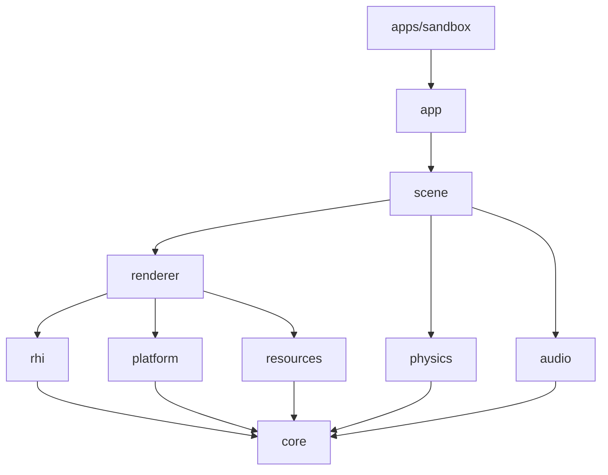
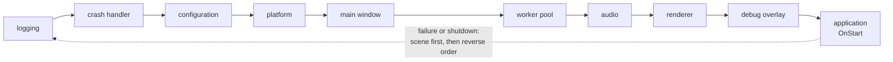
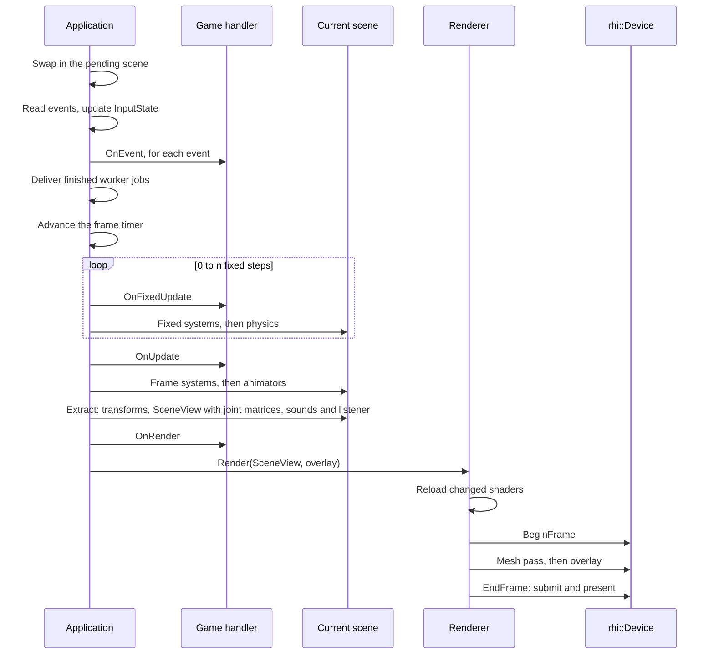
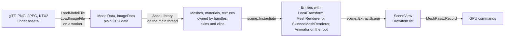
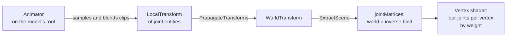
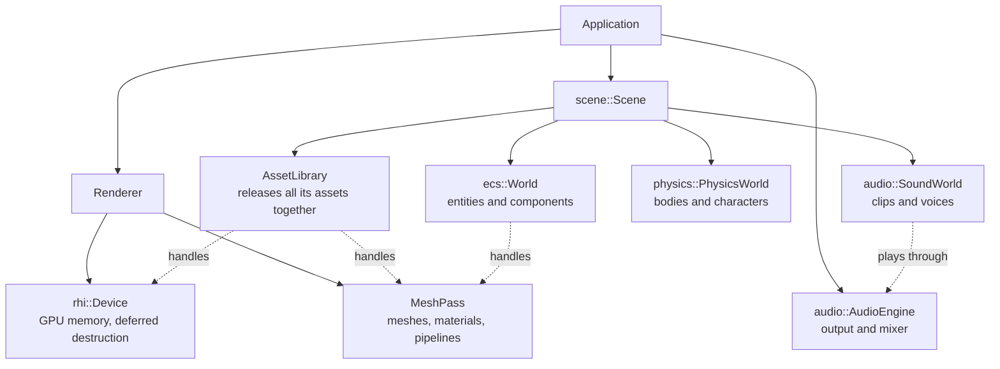
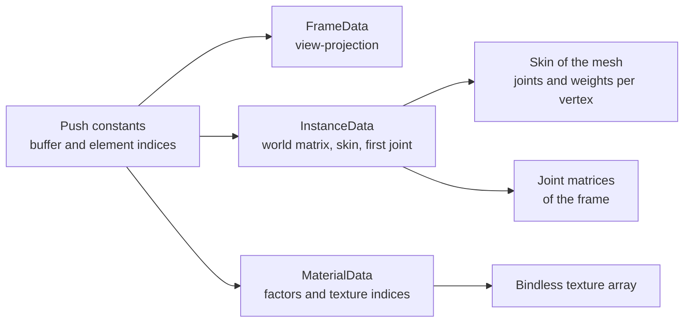

# Architecture

How the engine is built today, through Phase 6: physics, audio and animation, and the sandbox's fighting. [OVERVIEW.md](../OVERVIEW.md) holds the vision and the roadmap, and [the ADRs](adr/README.md) hold the reasons for each decision. This page describes what the code does now, and it changes in the same pull request as the code.

## Modules

Each module is a static library in `engine/<module>/`. A module exists only if it is a real layer, or if it hides a large third-party library (ADR-0021). An arrow means "links to". The graph comes from the `CMakeLists.txt` files, and it has no cycles.

Every module also links to `core`; the graph only shows it for the bottom row.

| Module | Responsibility | Third-party libraries it hides |
|---|---|---|
| `core` | `Result`, `Error`, `DAI_ASSERT`, `DAI_TRY`, handles, slot pool, frame timer, worker pool, cvars, profiling macros, logging (`logging::`), conventions, transforms, projections and boxes (`math::`) | spdlog; GLM, tl::expected and Tracy are public on purpose |
| `platform` | Window, events, Vulkan surface, processes, crash dumps, and keyboard, mouse and gamepad state with actions (`input::`) | SDL3 |
| `resources` | Asset paths, caches, decoding of files into plain CPU data | fastgltf, KTX, stb |
| `rhi` | Vulkan 1.3 device, swapchain, buffers, textures, pipelines, command lists, batched uploads | Vulkan, volk, VMA |
| `renderer` | Draws a `SceneView`: mesh pass, skinning, materials, shader hot reload, and the debug overlay (`debugui::`, development builds) | Dear ImGui |
| `physics` | Collisions, characters and ray queries of a scene | Jolt |
| `audio` | Output, mixing, clips and voices of a scene, silent without an output | miniaudio, stb_vorbis |
| `scene` | Entities (`ecs::`), animation (`animation::`), the asset library, the engine's components, the systems that tie entities to the renderer, physics and sounds, and the scene itself | |
| `app` | Startup and shutdown in order, main loop, current scene | |

Headers are included by namespace, not by module: `<daidalos/math/Transform.hpp>` lives in `core`, and `<daidalos/ecs/World.hpp>` in `scene`.

Three rules keep this graph healthy:

- **Only `scene` knows about entities.** The renderer draws a `SceneView` of copies, and physics and audio know bodies and voices. `scene::ExtractScene`, `SyncKinematicBodies` and `SyncSoundEmitters` connect them to the ECS.
- **Nothing above `rhi` knows about Vulkan.** `rhi` hides it completely, with concrete classes and no virtual interface (ADR-0007). It does not depend on `platform`: it receives a callback that creates the surface, so it can run with no window, which the GPU tests rely on.
- **`resources` does not depend on `rhi`.** It produces plain CPU data, and `scene::AssetLibrary` turns that into GPU objects through the renderer (ADR-0016).

## Startup and shutdown

`app::Application::Start` starts each step in order. If a step fails, `Stop` releases whatever is started, in reverse order, so nothing runs half-initialized. A normal shutdown calls the same `Stop`.

The game plugs in through `app::IApplicationHandler`: `OnStart`, `OnEvent`, `OnFixedUpdate`, `OnUpdate`, `OnRender` and `OnStop`. It usually gives the application a `scene::Scene`, which the application then runs. `Stop` releases the scene before anything else, because its assets and sounds belong to the renderer and the audio engine, even if `OnStart` failed halfway. A machine with no audio output only gets a warning, and its scenes stay silent (ADR-0019).

## One frame

Everything here runs on the main thread, except the jobs of the worker pool (ADR-0011). The GPU runs in parallel, with up to two frames in flight.

`SceneView` holds copies, so rendering never touches the ECS. World transforms are recomputed from scratch every frame, during extraction, with no dirty flags (ADR-0006).

## From file to GPU

An asset's identity is its normalized path relative to the asset root. The case must match the file on disk, so a mismatch fails on Windows as well as on Linux. A shared texture is uploaded once. `LoadModel` does all of this at once, and `LoadModelAsync` keeps the main thread running during the first arrow. The uploads of the second arrow are only recorded: they reach the GPU together, ahead of the next frame, and nothing waits for them. Loading a replacement level happens in a second scene, which takes over when it is ready.

The sandbox's level comes from the legacy engine, through `scripts/import_legacy_level.py`: a single glTF file, whose node names tell the game what each node is (ADR-0017). Animated models have their own glTF files, which the level points to with `model=` in a node's name.

## Animation

Joints are entities, so animation only writes transforms, and everything else is the usual path (ADR-0020).

## Who owns what

Solid arrows own, and dotted arrows only refer. GPU objects are never held by pointer outside their owner. Everyone else holds a generational handle, which detects when its slot was freed or reused:

- A draw with a destroyed mesh is skipped, and a draw with a destroyed material uses the default one, so unloading assets before entities is safe.
- `Destroy*` invalidates the handle at once. The GPU object is released when the timeline semaphore shows that the GPU has finished with it.
- The renderer must outlive every `AssetLibrary`, which `Application::Stop` guarantees by releasing the scene first. There is no reference counting and no eviction (ADR-0016).

## How the GPU reads its data

The renderer uses bindless access: one descriptor set holds every texture and storage buffer, and each draw only pushes indices.

`MeshPass` keeps one frame slot per frame in flight, so the CPU never writes data the GPU is still reading. Shaders are HLSL, compiled to SPIR-V by DXC during the build and embedded in the binary. In development builds, the sources are watched and recompiled by the `dxc` executable (ADR-0009).

## Tests

| Location | What it covers | Needs a GPU |
|---|---|---|
| `tests/unit/<module>/` | Logic of one module, one executable per module | No |
| `tests/gpu/<module>/` | `rhi`, `renderer` (with the debug overlay) and `scene` on a real driver, with no mock device | Yes, or lavapipe on Linux |

CI runs on pull requests and on `main`: Windows MSVC and Linux Clang, in Debug, Release, ASan and Profile, plus a formatting check. Linux runs all GPU tests on lavapipe, under a virtual display. Windows runners have no Vulkan, so they skip those tests.

## Known gaps

- No tool produces KTX2 files yet, although the loader reads them.
- Lighting, clustering and ambient occlusion do not exist yet (Phase 7). Materials carry all the PBR data already, and the sandbox simulates darkness with fog, with one spot light without shadows for its flashlight.
- Sound passes through walls and doors: there is no occlusion.
- Volumes are read at startup and cannot change during play.
- Joint matrices are computed and uploaded for every skinned mesh, even out of view, and collisions use the bind pose of skinned meshes.
- Nothing culls: every `DrawItem` is drawn.
- There are no text input events, so ImGui text fields do not work.
- Creating a model's GPU objects still happens on the main thread: about 10 ms for the Factory level in Release, which is less than a frame at 60 Hz but more than one at 144 Hz.
- Levels can only carry gameplay data in the names of glTF nodes.
