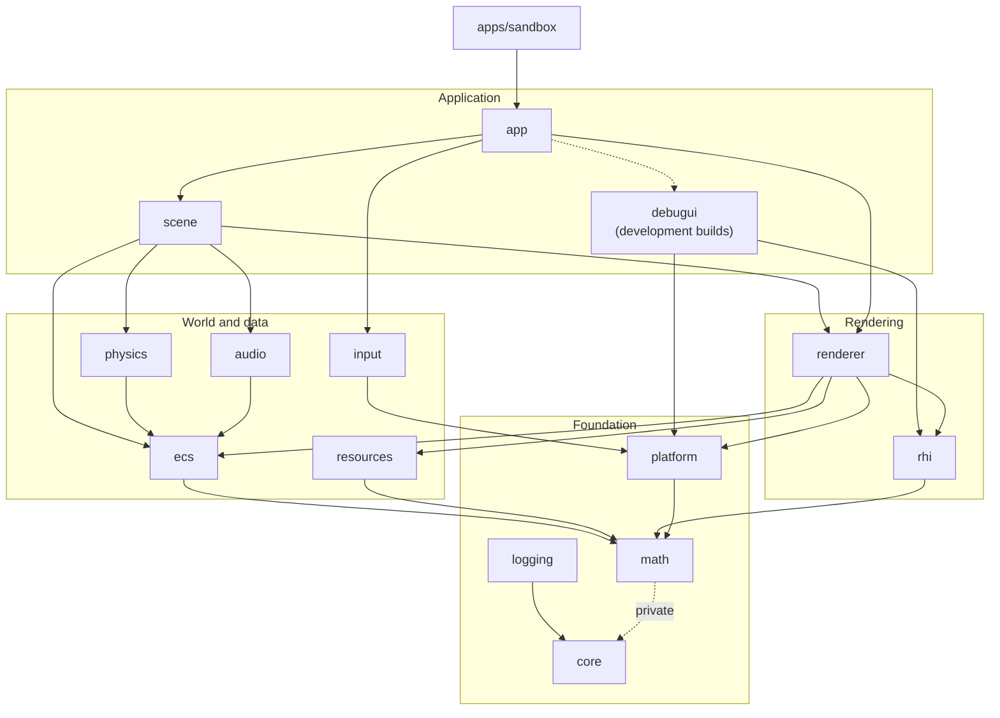
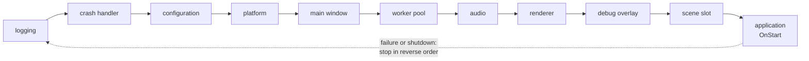
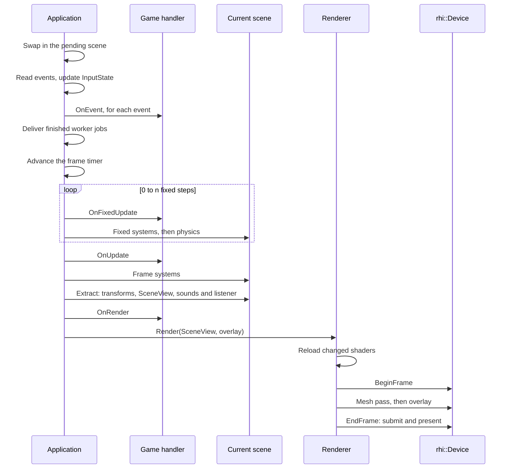
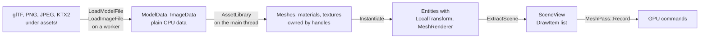
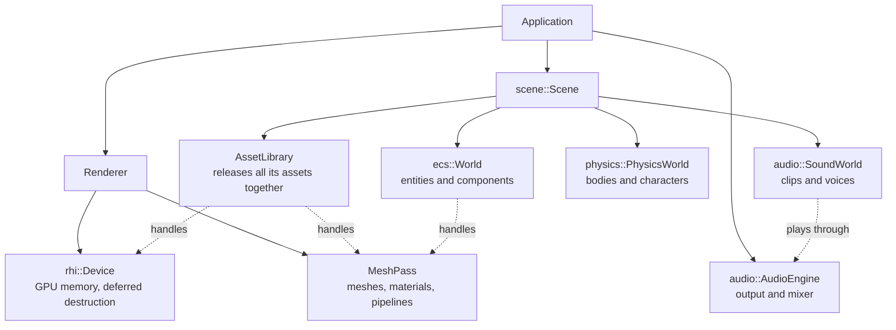
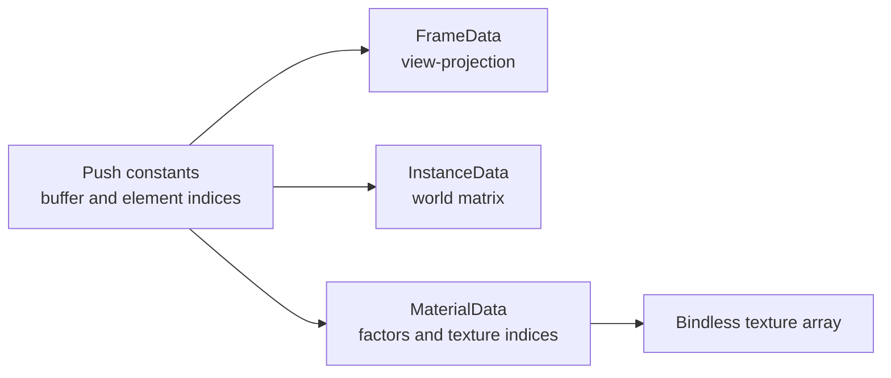

# Architecture

How the engine is built today, through the physics and audio parts of Phase 6. [OVERVIEW.md](../OVERVIEW.md) holds the vision and the roadmap, and [the ADRs](adr/README.md) hold the reasons for each decision. This page describes what the code does now, and it changes in the same pull request as the code.

## Modules

Each module is a static library in `engine/<module>/`, with public headers in `include/daidalos/<module>/`. An arrow means "links to". The graph comes from the `CMakeLists.txt` files, and it has no cycles.

To keep the graph readable, it omits the links to `core` and `logging` that nearly every module has.

| Module | Responsibility | Third-party libraries it hides |
|---|---|---|
| `core` | `Result`, `Error`, `DAI_ASSERT`, generational handles, slot pool, frame timer, worker pool, cvars, profiling macros | tl::expected and Tracy (both public) |
| `logging` | Logging facade | spdlog |
| `math` | Conventions, transforms, reverse-Z projections, bounding boxes | GLM (public, on purpose: ADR-0005) |
| `platform` | Window, events, Vulkan surface, processes, crash dumps | SDL3 |
| `input` | Held, pressed and released state for keyboard, mouse and gamepads, and actions | |
| `ecs` | Entities, sparse-set components, schedule, hierarchy, transform propagation | |
| `resources` | Asset paths, caches, decoding of files into plain CPU data | fastgltf, KTX, stb |
| `rhi` | Vulkan 1.3 device, swapchain, buffers, textures, pipelines, command lists | Vulkan, volk, VMA |
| `renderer` | Mesh pass, materials, asset library, cameras, ECS extraction, shader hot reload | |
| `physics` | Collisions and queries of a scene, with Jolt hidden inside | ADR-0018 |
| `audio` | Output, mixing, clips and voices of a scene, silent without an output | miniaudio, stb_vorbis |
| `scene` | A world with its assets, physics, sounds, systems, active camera and atmosphere | |
| `debugui` | Dear ImGui overlay drawn through the RHI | Dear ImGui |
| `app` | Ordered startup with rollback, main loop, current scene | |

Three rules keep this graph healthy:

- **Nothing below `renderer` knows about Vulkan.** `rhi` hides it completely, with concrete classes and no virtual interface (ADR-0007).
- **`rhi` does not depend on `platform`.** It receives a callback that creates the surface, so it can run with no window. The GPU tests rely on this.
- **`resources` does not depend on `rhi`.** It produces plain CPU data, and `renderer` turns that into GPU objects (ADR-0016).

## Startup and shutdown

`app::Application::Run` starts each step in order. If a step fails, the steps that already started are stopped in reverse order, so nothing runs half-initialized. A normal shutdown takes the same path.

The game plugs in through `app::IApplicationHandler`: `OnStart`, `OnEvent`, `OnFixedUpdate`, `OnUpdate`, `OnRender` and `OnStop`. It usually gives the application a `scene::Scene`, which the application then runs. The scene slot makes sure that the scene goes before the renderer and the audio engine, even if `OnStart` fails. A machine with no audio output only gets a warning, and its scenes stay silent (ADR-0019).

## One frame

Everything here runs on the main thread, except the jobs of the worker pool (ADR-0011). The GPU runs in parallel, with up to two frames in flight.

`SceneView` holds copies, so rendering never touches the ECS. World transforms are recomputed from scratch every frame, during extraction, with no dirty flags (ADR-0006).

## From file to GPU

An asset's identity is its normalized path relative to the asset root. The case must match the file on disk, so a mismatch fails on Windows as well as on Linux. A shared texture is uploaded once. `LoadModel` does all of this at once, and `LoadModelAsync` keeps the main thread running during the first arrow. Loading a replacement level happens in a second scene, which takes over when it is ready.

The sandbox's level comes from the legacy engine, through `scripts/import_legacy_level.py`: a single glTF file, whose node names tell the game what each node is (ADR-0017).

## Who owns what

Solid arrows own, and dotted arrows only refer. GPU objects are never held by pointer outside their owner. Everyone else holds a generational handle, which detects when its slot was freed or reused:

- A draw with a destroyed mesh is skipped, and a draw with a destroyed material uses the default one, so unloading assets before entities is safe.
- `Destroy*` invalidates the handle at once. The GPU object is released when the timeline semaphore shows that the GPU has finished with it.
- The renderer must outlive every `AssetLibrary`, which the application's scene slot guarantees. There is no reference counting and no eviction (ADR-0016).

## How the GPU reads its data

The renderer uses bindless access: one descriptor set holds every texture and storage buffer, and each draw only pushes indices.

`MeshPass` keeps one frame slot per frame in flight, so the CPU never writes data the GPU is still reading. Shaders are HLSL, compiled to SPIR-V by DXC during the build and embedded in the binary. In development builds, the sources are watched and recompiled by the `dxc` executable (ADR-0009).

## Tests

| Location | What it covers | Needs a GPU |
|---|---|---|
| `tests/unit/<module>/` | Logic of one module, one executable per module | No |
| `tests/gpu/<module>/` | `rhi`, `renderer`, `scene` and `debugui` on a real driver, with no mock device | Yes, or lavapipe on Linux |

CI runs on pull requests and on `main`: Windows MSVC and Linux Clang, in Debug, Release, ASan and Profile, plus a formatting check. Linux runs all GPU tests on lavapipe, under a virtual display. Windows runners have no Vulkan, so they skip those tests.

## Known gaps

- No tool produces KTX2 files yet, although the loader reads them.
- Lighting, clustering and ambient occlusion do not exist yet (Phase 7). Materials carry all the PBR data already, and the sandbox simulates darkness with fog, with one spot light without shadows for its flashlight.
- Rays pass through characters, so weapons cannot hit them yet (Phase 6).
- Sound passes through walls and doors: there is no occlusion.
- Volumes are read at startup and cannot change during play.
- Meshes cannot be animated (Phase 6).
- Nothing culls: every `DrawItem` is drawn.
- There are no text input events, so ImGui text fields do not work.
- Creating a model's GPU objects still happens all at once on the main thread, which can cause a hitch at the end of a load.
- Levels can only carry gameplay data in the names of glTF nodes.
