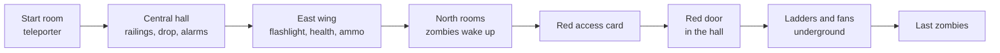

# The demo

The sandbox is becoming a remake of the demo of the legacy Daidalos engine: a first-person shooter in the spirit of Doom and Quake, set in a dark underground factory. It serves as the engine's test bench: each phase of the [roadmap](../OVERVIEW.md) must make it better, so nothing is built without a real use.

## The original

The legacy demo lives in `../daidalos-engine`. Its level, `Resources/Scenes/factory.des`, is laid out on a grid of 10-unit tiles. This route is read from the level file and the code, not from playing it: the legacy executable has not been run.



| Theme | What it had | Numbers worth keeping |
|---|---|---|
| Player | Walk, run, crouch, jump, ladders, footsteps, fall sounds | 3.5 m/s, run ×1.7, crouch ×0.6, 80 health at the start |
| Weapons | Handgun and shotgun, reloads, muzzle flash, smoke, weapon sway | Handgun: 12 rounds, 10 damage, 350 ms. Shotgun: 7 rounds, 5 pellets of 12 damage, 1200 ms |
| Zombies | Patrol, wait, follow, attack and die states, groans, blood | 50 health, 12 damage every 800 ms, view 60° over 12 m, search 9 s |
| Pickups | Health, armor, ammunition, flashlight, red card, spinning | Armor +50, handgun +12, shotgun +7 |
| World | Doors, card reader, fans, alarms, security camera, spot lights, green fog | Doors open 3.5 m away, stay 6 s |
| Screen | HUD, crosshair, loading screen, opening camera flight | |

## How it grows

| Phase | The demo gains | Status |
|---|---|---|
| 5: Scene | The level in the new engine, background loading, restart, flying, doors, pickups, red card, darkness | Done |
| 6: Physics and audio | Walking with collisions, jumps, crouching and ladders, solid doors, hitscan weapons, sound, zombies with skeletal animation and their state machine, damage and death | Next |
| 7: Modern rendering | Real lights replacing the fog, the flashlight's shadow, rotating alarms, normal maps, ambient occlusion, particles for smoke, blood and green fog | |
| 8: GUI | The game's own HUD, crosshair, menus and loading screen | |
| 9: AI, cinematics, optimization | Security camera, opening camera flight, better zombie navigation, culling | |

Zombies come earlier than the roadmap's AI phase, because a shooter with no one to shoot is not a demo. Their state machine belongs to the game, and Phase 9 only adds what they turn out to lack.

## Where it should improve on the original

- **Pace.** Faster movement, more enemies, ambushes when doors open: closer to Doom than to the original's slow zombies.
- **Feel.** Hit feedback, screen flash on damage, stronger recoil and sway.
- **Structure.** The factory level has shotgun ammunition, but no shotgun to pick up. The remake gets a shotgun pickup, a clear exit and an end-of-level summary of kills, items and time.
- **Sound.** Spatial audio with occlusion by doors, if the audio library makes that cheap.

## Running it

The level is converted from the legacy repository. The result goes to `assets/Factory/`, which git ignores.

```bash
python scripts/import_legacy_level.py ../daidalos-engine/Resources
build/windows-msvc/apps/sandbox/Release/sandbox.exe
```

Without the level, the sandbox shows a test floor. Other glTF files can be tried with `+sandbox.scene <path>`.

| Control | Action |
|---|---|
| Mouse, right stick | Look |
| W, A, S, D, left stick | Move |
| Space, C | Up, down, while the player flies (Phase 5) |
| Shift | Run |
| E | Use a door |
| F | Flashlight |
| F5 | Restart |
| Tab | Free the mouse |
| Escape | Quit |

`sandbox.start` places the player, with `x y z yaw pitch` in meters and degrees, and `sandbox.darkness 0` lights the whole level. Both are useful to reach a place quickly.

## Assets

The origin of the legacy assets is unknown: there are no licence files, and some of them clearly come from elsewhere. For example, the handgun texture shows a real product, and `eva_d.png` looks like a licensed character. Until each one is cleared or replaced:

- They stay out of the repository, because `assets/` is ignored by git.
- They do not appear in Patreon posts, whose rules require a licence that allows it.

The level's layout, its numbers and its code are the project's own. Only the art and the sounds are in question. They must be cleared or replaced before the demo is shown or released.
