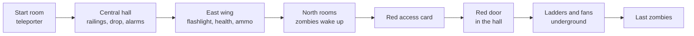

# The demo

The sandbox is becoming a remake of the demo of the legacy Daidalos engine: a first-person shooter in the spirit of Doom and Quake, set in a dark underground factory. It serves as the engine's test bench: each phase of the [roadmap](../OVERVIEW.md) must make it better, so nothing is built without a real use.

## The original

The legacy demo lives in `../daidalos-engine`. Its level, `Resources/Scenes/factory.des`, is laid out on a grid of 10-unit tiles. This route is read from the level file and the code, not from playing it: the legacy executable has not been run.



| Theme | What it had | Numbers worth keeping |
|---|---|---|
| Player | Walk, run, crouch, jump, ladders, footsteps, fall sounds | 3.5 m/s, run ×1.7, crouch ×0.6, 80 health at the start |
| Weapons | Handgun and shotgun, reloads, muzzle flash, smoke, weapon sway | Handgun: 12 rounds, 10 damage, 350 ms. Shotgun: 7 rounds, 5 pellets of 12 damage, 1200 ms |
| Zombies | Patrol, wait, follow, attack and die states, groans, blood | 50 health, 12 damage every 800 ms, view 60° over 12 m, search 9 s |
| Pickups | Health, armor, ammunition, flashlight, red card, spinning | Armor +50, handgun +12, shotgun +7 |
| World | Doors, card reader, fans, alarms, security camera, spot lights, green fog | Doors open 3.5 m away, stay 6 s |
| Screen | HUD, crosshair, loading screen, opening camera flight | |

## How it grows

| Phase | The demo gains | Status |
|---|---|---|
| 5: Scene | The level in the new engine, background loading, restart, doors, pickups, red card, darkness | Done |
| 6: Physics, audio and animation | Walking with collisions, jumps, crouching, ladders and solid doors, sound, skinned zombies and turning fans, hitscan handgun and shotgun, zombies that hunt, wounds and death | Done |
| 7: Modern rendering | Real lights replacing the fog, the flashlight's shadow, rotating alarms, normal maps, ambient occlusion, particles for smoke, blood and green fog | 7.1 to 7.3 done: lights, alarms, normal maps, shadows, ambient occlusion |
| 8: GUI | The game's own HUD, crosshair, menus and loading screen | |
| 9: AI, cinematics, optimization | Security camera, opening camera flight, better zombie navigation, culling | |

Zombies come earlier than the roadmap's AI phase, because a shooter with no one to shoot is not a demo. Their state machine belongs to the game, and Phase 9 only adds what they turn out to lack.

## Where it should improve on the original

- **Pace.** Faster movement, more enemies, ambushes when doors open: closer to Doom than to the original's slow zombies.
- **Feel.** Hit feedback, screen flash on damage, stronger recoil and sway.
- **Structure.** The factory level has shotgun ammunition, but no shotgun to pick up. The remake has a shotgun next to the shells, and still needs a clear exit and an end-of-level summary of kills, items and time.
- **Sound.** Spatial audio is done. Occlusion by doors can come later, with rays from the listener.

## Running it

The level is committed in `assets/Factory/`, so the demo only needs a build. The executable finds it from its own location, so a double-click works:

```bash
build/windows-msvc/apps/sandbox/Release/sandbox.exe
```

If the level is missing, the sandbox shows a test floor. Other glTF files can be tried with `+sandbox.scene <path>`.

`scripts/import_legacy_level.py` is not part of running the demo. It converts the legacy level again, or brings more legacy content over. It also bakes the animated MilkShape models to glTF files of their own: the zombie, the fans and the handgun, whose clips are the frame ranges the legacy game played.

## The fight

The numbers come from the original's code, except where the table says otherwise.

| | How it works |
|---|---|
| Handgun | 12 rounds, 10 damage, a shot every 0.35 s, reloads in 1.5 s (2 s in the original). Starts loaded, with nothing to reload it |
| Shotgun | 7 shells, 5 pellets of 12 damage, a shot every 1.2 s, reloads in 2.8 s. It lies next to the shotgun shells: the original had it in its code, but nowhere to pick it up, and no model. `scripts/make_shotgun.py` builds one |
| Aim | Rays from the eyes, spread as the original spread its bullets, up to 35 m. A shot is heard by zombies within 20 m |
| Zombies | 50 health. They see 12 m ahead, within 60° of where they face, if nothing is in between. They walk at 1.3 m/s, faster than the original's 0.7, straight at the player: there is no path finding. They strike for 12 every 1.5 s within 1.4 m, look for a lost player for 9 s, then go back to waiting, or to their patrol |
| Wounds | Armor takes half of each wound while it lasts. At 0 health the player falls, and F5 starts again |

| Control | Action |
|---|---|
| Mouse, right stick | Look |
| W, A, S, D, left stick | Move |
| Shift | Run |
| Space | Jump |
| C, left Ctrl | Crouch |
| W on a ladder | Climb up, or down when looking down |
| Left button, right trigger | Fire |
| R, right shoulder | Reload |
| 1, 2, Q, wheel, D-pad up | Change weapons |
| E | Use a door |
| F | Flashlight |
| F5 | Restart |
| Tab | Free the mouse |
| Escape | Quit |

The sandbox reads its settings from `sandbox.cfg` next to the executable, which the build copies from `apps/sandbox/sandbox.cfg` the first time and leaves alone afterwards, and the command line overrides it with `+name value`. `sandbox.start` places the player, with `x y z yaw pitch` in meters and degrees, and `sandbox.darkness 0` lights the whole level. `sandbox.flashlight true` starts with the flashlight on. `sandbox.ambient` sets how much light reaches everywhere in the dark, 0.1 by default, and 0 for pitch black away from lamps. Both are useful to reach a place quickly. The value of `sandbox.start` holds spaces, so it is quoted on the command line: `+sandbox.start "31.5 4.3 -54 0 -25"` looks down at a lit ceiling spot, whose room has its floor at 2.8 m, and `+sandbox.start "0 1.5 -36 0 10"` faces the turning alarms.

## Assets

The geometry and `handgun_ammo_d.png` are the author's own work. The other textures and the sounds are free assets whose licences allow commercial use. [assets/Factory/LICENSE.md](../assets/Factory/LICENSE.md) has the details.

Some legacy content is left out:

- `eva.md2` and its texture `eva_d.png`, a test model the level does not use.
- `test.wav` and `test2.wav`, which are leftover tests.
- `enter_the_maze.wav`, the level's ambient track, which is committed as a 3.4 MB OGG file instead.

The site the free assets came from is not recorded yet, and Patreon screenshots need it for attribution.
