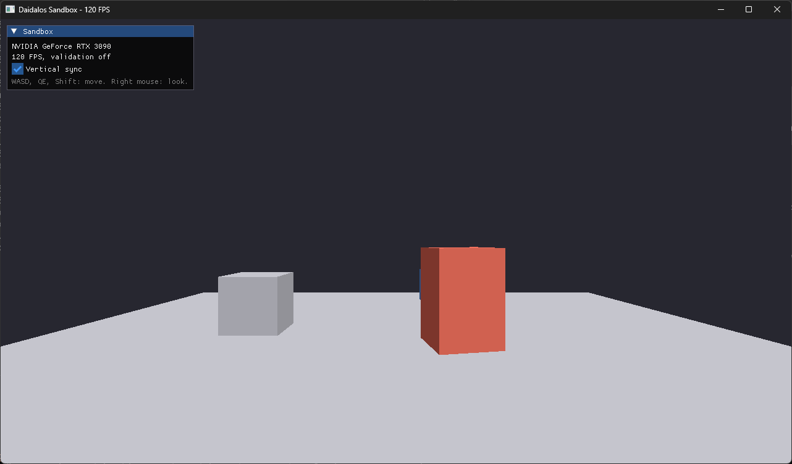

# Why I'm rebuilding my engine

Hello, and welcome to the development diary of Daidalos Engine Next.

Daidalos is a real-time 3D engine that I write myself in C++. The copyright line at the top of its source files starts in 2011, so this is not a new idea of mine. "Next" is the point of this project: I'm rebuilding it from the ground up on modern foundations.

[TO WRITE: the story of the original Daidalos. What it was, what I made with it, why I set it aside.]

[TO WRITE: why now, and what I hope to make with it.]

*This is the engine today. It isn't much to look at yet, but everything between the keyboard and that picture is mine or was chosen by me, and it all runs on Vulkan 1.3.*

## What I'm building

Daidalos Engine Next targets indoor 3D games, in first or third person. That focus matters. I'm not trying to rebuild Unreal or Unity. Corridors, rooms and doors allow a much smaller engine than open worlds, and a smaller engine is one I can actually finish.

The goal is an engine that covers everything a complete game needs: rendering, physics, audio, input, a user interface, gameplay systems and development tools. It should run on Windows and Linux.

## The constraint that shapes everything

I have about three hours a week for this project.

That single number drives most of my technical decisions. An idea that is exciting but costs months of maintenance gets rejected. When a mature library solves a well-understood problem, I use it: SDL3 for windows today, Jolt for physics and miniaudio for sound later. I keep for myself the parts I want to understand deeply and control, such as the rendering layer and the entity system.

## How I work: me and Claude Code

I develop this engine with Claude Code, Anthropic's AI coding assistant, and I want to be upfront about it.

Here is how it works in practice. Before each phase, I review a plan and the technical choices behind it. I've asked Claude to challenge my decisions rather than simply go along with them, and nothing starts until I approve it. Claude then does much of the implementation and writes the tests, and the code has to build and pass them. The architecture stays my responsibility, and I have to be able to understand and maintain everything that lands in the repository.

Every lasting decision is written down in a short Architecture Decision Record, so I can always find out why something is the way it is. There are 15 so far.

I'll be showing you how this works in practice, including where it helps and where it doesn't.

## What you'll find here

- **Architecture posts**, explaining how the engine works and why, with diagrams.
- **Progress posts**, at the end of each development phase, with screenshots and honest numbers.
- **Roadmap updates**, when the plan changes.

I'll also tell you what doesn't work. Unfinished and unverified parts are clearly marked. A diary that only shows the good days isn't much use to anyone.

Next up: a tour of how the engine fits together.
