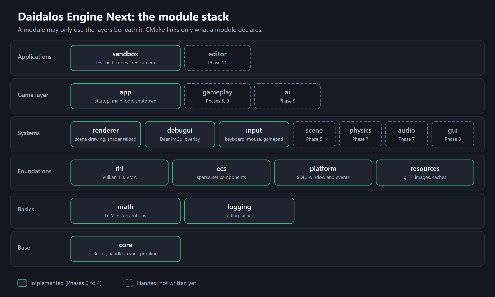
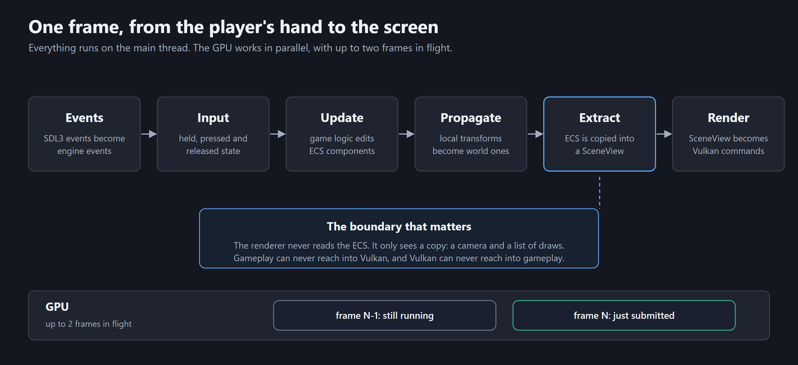

# How the engine fits together

Game engines tend to die the same way: everything ends up depending on everything else, until touching the audio code somehow breaks the shadows. With three hours a week, I can't afford that. So the first thing I designed wasn't a feature, it was a set of walls.

## A stack of modules

The engine is a stack of small libraries. The rule is simple: **a module may only use the layers beneath it.** Each module declares its dependencies in its build file, and anything it doesn't declare isn't linked. The renderer can use the entity system, but the entity system has no idea that a renderer exists, let alone Vulkan.

The green boxes exist today, ten engine modules plus the sandbox I test them in. The dashed ones are promises. They'll get written when a phase needs them, and not before.

## The journey of one frame

Here's what happens many times a second:

1. **Events and input.** The operating system's events are translated into the engine's own, so nothing above this point knows about SDL3 or Windows.
2. **Update.** Game logic changes components: a door opens, the camera moves.
3. **Propagate.** Objects can be attached to one another, like a lamp on a moving platform. This step turns each object's local position into its final world position. I chose to recompute all of them every frame instead of tracking what changed. It's simple, it can't go stale, and I'll only optimize it if measurements tell me to.
4. **Extract.** The engine copies what needs drawing into a plain list called a `SceneView`.
5. **Render.** The renderer turns that list into commands for the graphics card.

Step 4 is the wall that matters most. The renderer never touches game state. It only ever sees that copy, so gameplay code and Vulkan code can't get tangled together.

## Four decisions that define the engine

**Vulkan only.** The original plan was DirectX 12 first and Vulkan later. I dropped that. Vulkan runs on both Windows and Linux, and two backends would double the work for every rendering feature. Between the renderer and Vulkan sits a thin layer, the RHI, whose only job is to keep Vulkan details out of the renderer. It isn't a universal abstraction waiting for backends that will never come.

**Clustered forward rendering.** This one is still ahead of me, in Phase 6. The classic alternative, deferred rendering, makes transparency and anti-aliasing harder. Clustered forward splits the view into a 3D grid and works out which lights touch each cell, which suits indoor scenes with many small lights.

**An entity-component system.** A game object isn't a class in a big inheritance tree. It's an ID, with components attached: a transform, a mesh, a camera. It's custom rather than a library, because it sits at the heart of everything. IDs carry a generation counter, so an ID left over from a deleted object is detected instead of silently pointing at whatever replaced it.

**Errors are values.** Functions that can fail return a `Result`, which holds either the value or a description of the error. There are no exceptions crossing module boundaries. Failure is visible right in the function's signature, and the compiler warns when a result is ignored.

## What I left out on purpose

No BSP trees. No custom file formats. No general job system. No editor yet. Each of these is either unnecessary on modern hardware or premature today, and each could return if a measurement proves me wrong.

Most of my architecture work so far has been deciding what not to build. Next time: the roadmap.
