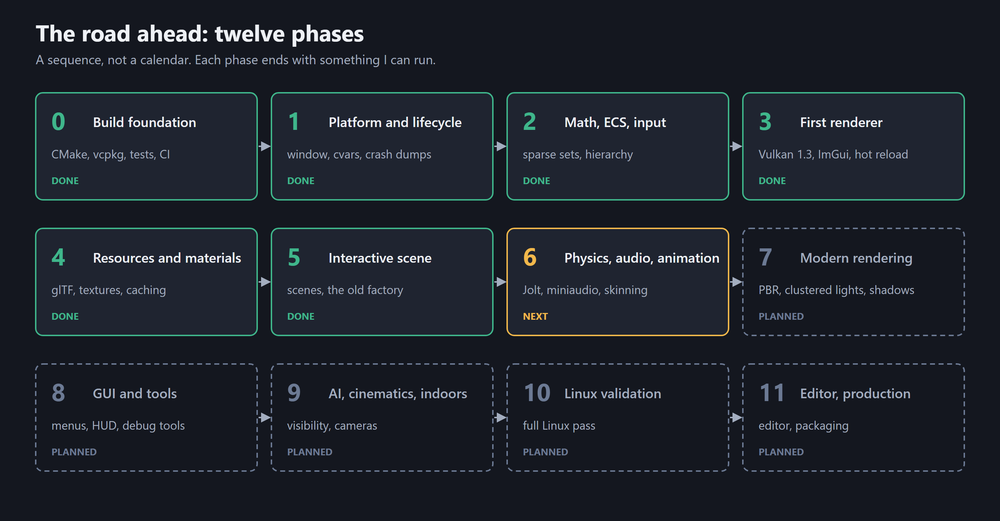

# The road ahead

An engine has no natural finish line, which makes it dangerous for a solo developer. So I cut mine into twelve phases, each with a clear goal and concrete completion criteria. It's a sequence, not a calendar: I won't give dates I can't keep.

## Done

**Phases 0 to 3** took me from an empty build to a Vulkan renderer drawing an interactive scene. That's the subject of the next post.

**Phase 4** taught the engine to load real 3D models and textures from files, so that it no longer lives on cubes described in the code.

## Next

**Phase 5: an interactive scene.** Scenes and the first gameplay: the factory from my old demo, in the new engine.

## Later

- **Phase 6, physics, audio and animation.** Jolt and miniaudio, so that the world gets solid and starts making noise, and skeletal animation, so that characters can move.
- **Phase 7, modern rendering.** The big visual step: physically based materials, normal mapping, clustered lighting, shadows, ambient occlusion and particles.
- **Phase 8, GUI and tools.** Menus, a HUD, loading screens and inspectors for looking inside the running engine.
- **Phase 9, AI, cinematics and indoor optimization.** State machines, camera sequences, and visibility work, but only where measurements show that it pays off.
- **Phase 10, Linux validation.** A complete pass over everything on Linux. It's designed in from the start, and this is where it gets proven.
- **Phase 11, editor and production readiness.** A real editor, and what's needed to ship a game.

## The plan will change

I don't put dates on any of this. The first four phases went much faster than I expected, as you'll see in the next post, but they were also the best-understood part. I'd rather take stock after each phase than pretend that I can see the end from here.

Whenever the plan changes, I'll tell you here, and why.
