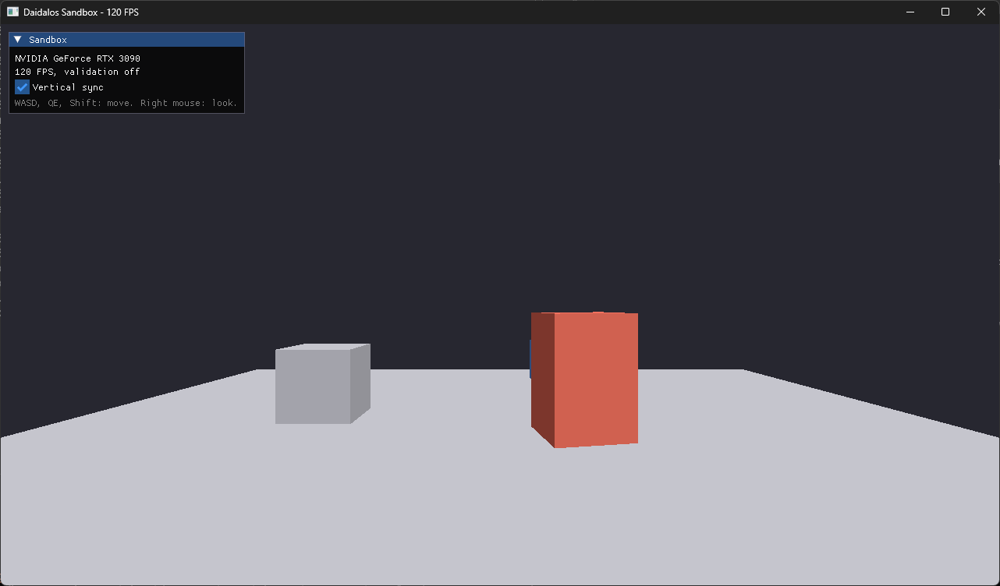
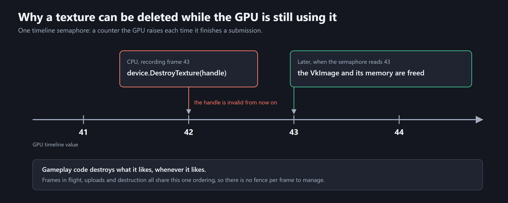

# From an empty repository to a first frame

Here it is: a gray box and a spinning red box on a floor. A small blue cube, hidden behind the red box in this shot, orbits it because it's attached to it. You can fly around with a keyboard and mouse or a gamepad.

It doesn't look like much, but this picture sits on top of four phases of the roadmap.

## Phase 0: the part nobody sees

No graphics at all here. I replaced the old Visual Studio solution with CMake and vcpkg, so that a fresh machine can build the project with a few commands, and set up tests, automatic formatting and continuous integration. Not glamorous, but every later phase relies on it.

## Phase 1: a window that behaves

A window through SDL3, and an application lifecycle with one clear rule: startup is a list of ordered steps, and if step 5 fails, steps 4 to 1 are undone in reverse order. Add to that a crash handler that writes dump files on Windows, the Tracy profiler, and configuration variables that I can set from a file or the command line.

## Phase 2: the foundations of a world

Math with fixed conventions, input from keyboard, mouse and gamepad, and the entity-component system I described in the architecture post, with parent-child hierarchy. Still nothing on screen, but already a few hundred tests.

## Phase 3: Vulkan

This is the big one. Vulkan is famously verbose, and it leaves you in charge of everything the old APIs did for you, including memory and synchronization between the CPU and the GPU.

One piece of this phase solves a classic trap. The CPU races ahead of the GPU, so when your code deletes a texture, the GPU may still be drawing with it. Delete it for real at that moment and you crash, or worse, you corrupt a frame.

The usual answer involves one fence per frame and some bookkeeping. I went with something simpler: a single timeline semaphore, a counter that the GPU raises as it finishes work. Deleting a resource invalidates its handle at once and notes the value that the current frame will reach. When the counter gets there, the real release happens. Frames, uploads and deletions all share that single ordering.

The phase also brought a Dear ImGui debug overlay, drawn through my own rendering layer, and shader hot reload: I edit a shader, save, and the running engine picks it up. If I've broken it, the previous version keeps running and the compiler's error appears in the overlay.

## The numbers

| | |
|---|---|
| Engine modules | 10 |
| Engine and sandbox code | about 8,300 lines |
| Test code | about 4,800 lines |
| Automated tests | 322, passing on Windows in Debug |
| Commits | 33, from 27 to 31 October |

## The elephant in the room

My plan estimated roughly 150 to 290 hours for this stretch, which at three hours a week means a year or two. It landed in five days.

This is what working with Claude Code changes. It doesn't change who's accountable for the code, and I'm wary of reading too much into that figure: this is the most thoroughly documented part of any engine, and a lot of it hasn't faced real-world use yet. Harder questions are coming, where the answer isn't in any book.

[TO WRITE: how those five days actually felt, how much time I really spent, and what surprised me.]

## What isn't verified yet

- **Linux.** It has been designed in from the start, but the work of Phases 2 and 3 has only been run on my Windows machine. Until the automated Linux builds pass, I won't call it working.
- **One GPU.** Everything graphical has run on one card, an RTX 3090, with a clean validation log.
- **Text fields in the overlay** don't work yet, because the engine doesn't handle text input events yet.
- **Lighting is fake.** There's one hard-coded light in the shader. Real lights arrive in Phase 6.

## Next

Phase 4: real models and textures loaded from files. Goodbye, cubes.
