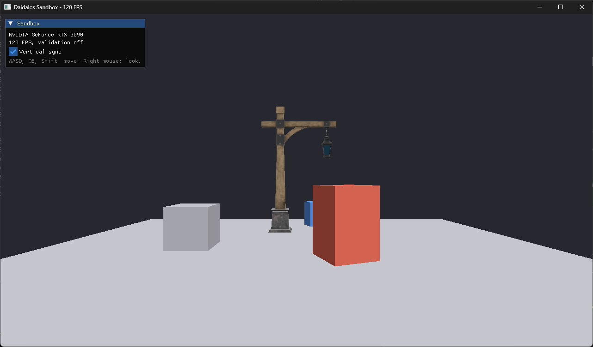
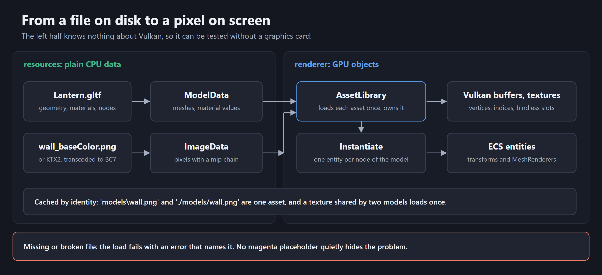

# Goodbye, cubes

That lantern post is the first thing this rebuilt engine has drawn that wasn't typed into its code. It's a glTF file with its own textures, loaded from disk. The cubes are still there, looking rather plain next to it.

The lighting is the same fake light as before, so nothing here is shaded realistically yet. What's new is everything needed to get real content onto the screen.

## From file to screen

The important line in this diagram runs down the middle. On the left, the `resources` module reads files and produces plain data: lists of vertices, pixels, material values. It knows nothing about Vulkan, so all of it can be tested on a machine with no graphics card. On the right, the renderer turns that data into GPU objects.

Glossary for this post:

- **glTF** is the open standard for 3D models. Think of it as the JPEG of 3D.
- **Mip levels** are smaller copies of a texture, down to one pixel. The GPU picks the right size for the distance, which avoids shimmering.
- **BC7 and BC5** are texture compression formats that the GPU reads directly.

## Three things I refused to build

The original plan called for a `ResourceManager`, with loaders registered by file extension. That's how my old engine did it. I dropped it: the engine knows all its asset types at compile time, so a registry would be indirection with nothing behind it. There are typed load functions and small caches instead.

I also dropped reference counting. Scene assets arrive together and leave together, so one object, the `AssetLibrary`, owns everything it loads and releases it all at once. There's nothing to count. Asking twice for the same file returns the same object, even when the path is spelled differently. A texture shared by two models is loaded once.

And there are no magenta placeholder textures. A missing or broken file stops the load with an error that names it. A placeholder is friendly right up to the day it ships.

## Two surprises

**My plan had a mistake in it.** My decision record said BC7 textures would be produced by `toktx` or `texconv`. When I checked, neither can do that: one doesn't encode BC7 at all, and the other writes a different file format. The fix turned out to be a better design: store textures in a universal format called UASTC, and transcode them to BC7 when they load. The record now says so.

**The obvious test scene wasn't free to use.** Sponza, the classic indoor graphics test, was my first choice. When I checked the licence for this very post, I found that it's under CRYENGINE's own terms rather than an open licence. Since this diary lives on a paid platform, I switched to the Lantern, which is released under CC0. Sponza may come back in a private test, but it won't appear here unless I can show that it's allowed.

## A small change with long reach

The GPU only guarantees 128 bytes for the quick per-draw data called push constants, and two matrices had already filled them. There was no room left to say which material to use. So that data moved into storage buffers, and the push constants now only carry indices. It's invisible in this picture, but the lights of Phase 6 will travel the same road.

## The numbers

| | |
|---|---|
| Automated tests | 367, up from 322 |
| New module | `resources`, the eleventh |
| Legacy code | the old `Core/` folder is deleted, now that its resource code has been replaced |
| Model on screen | Lantern, about 9 MB, at 120 FPS with vertical sync |

[TO WRITE: what it felt like to see a real model in the engine for the first time.]

## What isn't verified yet

- **Linux.** Phase 4 has only run on my Windows machine so far. The new code passed a Clang warnings check, but the real test is the automated Linux build.
- **KTX2 in production.** Loading compressed KTX2 works and is tested, but no tool in my pipeline creates those files yet, so the Lantern still uses plain PNGs, with mip levels computed at load time.
- **Normal maps and metal.** The engine reads and stores every material value, but only the base color is shaded for now. That's Phase 6.
- **Transparency.** Cut-out alpha works. Real see-through materials are drawn opaque for now.
- **Loading blocks the window** while it runs. A worker thread arrives in Phase 5.

## Next

Phase 5: an interactive scene, with scene files and the first gameplay. The sandbox is about to become something you can do things in.
