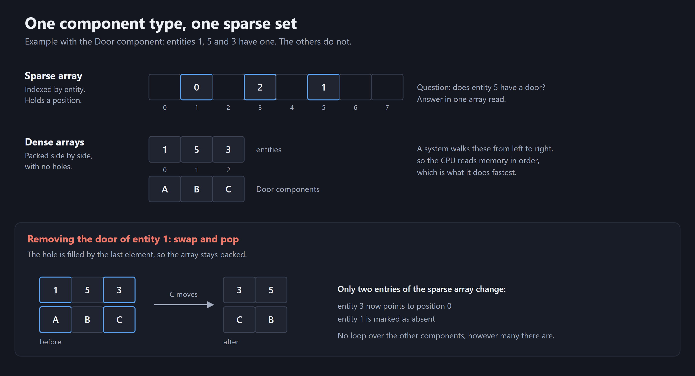

# What is a door made of?

*Inside the engine: short posts about one part of Daidalos Engine Next.*

In my engine, a door doesn't really exist. There's a number, say 42, and that number is listed in a few tables: one for positions, one for meshes, one for doors, one for collision. That's an **Entity Component System**, or ECS.

- An **entity** is only a number.
- A **component** is plain data attached to it, like a position or a door's state.
- A **system** is a function that runs over everything that has a given set of components. The door system visits everything with a `Door` and a position, and nothing else.

## The table behind it

Each component type has its own table, built as a **sparse set**: one array to find things quickly, and packed arrays to walk through them quickly.



Asking "does entity 5 have a door?" takes a single array read. Going through every door walks packed memory from start to finish, which is what processors do fastest. And removing a door doesn't shift the others: the last one moves into the hole.

When a system needs several components, it walks the shortest table and looks up the others, so a rare component keeps the query cheap.

## The trade-offs

EnTT is an excellent open-source ECS that works in much the same way. I went with my own because understanding this part deeply is one of the goals of the project. If it ever becomes a burden, EnTT can replace it without a redesign.

The other choice is that systems run in an order written down in one place, not one worked out automatically:

```cpp
fixed.Add("Movement", ...);
fixed.Add("Doors", ...);
```

It's less clever, but I can read it.

There's one rule to respect: while a system walks a table, nothing may add to it or remove from it, because that would move the elements being visited. Development builds stop at once if a system tries.

Next in this series: how the engine notices that an entity no longer exists.
