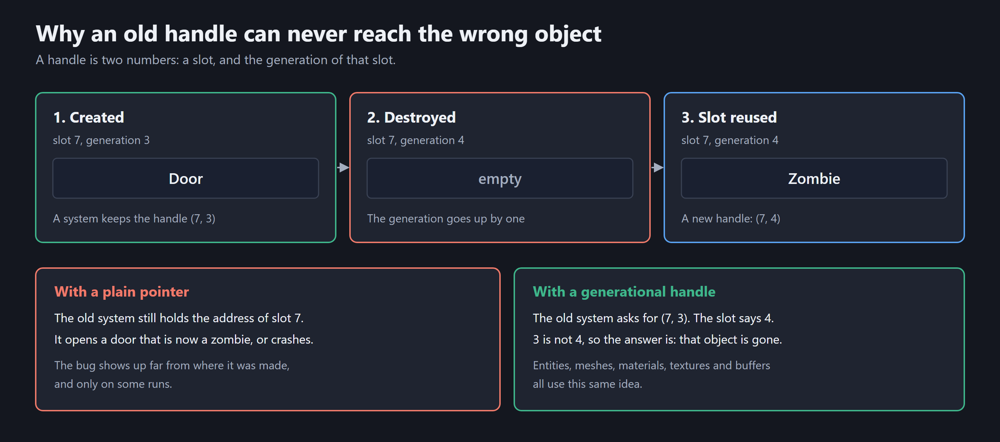

# The handle that knows its object is gone

*Inside the engine: short posts about one part of Daidalos Engine Next.*

Here's a classic bug in games. An enemy remembers its target. The target dies and its memory is reused for something else. The enemy then attacks a crate, or the game crashes, a long way from the real mistake.

The new engine avoids this with one small idea, used almost everywhere.



A **handle** is two numbers: which slot, and which **generation** of that slot. Destroying an object adds one to the slot's generation. An old handle still says 3 while the slot says 4, so the mismatch shows that its object is gone, even if something new lives there now.

The check is one integer comparison.

## What this changes in practice

Code that keeps a reference can simply ask whether the object is still there:

```cpp
if (Door* door = world.TryGet<Door>(entity)) {
    // Still alive, and it still has a door.
}
```

The same idea makes the order of destruction forgiving. If a level's assets are released before its entities, a draw with a destroyed mesh is skipped, and a draw with a destroyed material uses the default one.

Entities, meshes, materials, textures, buffers and pipelines all use this. Each kind of handle is its own type too, so the compiler refuses a texture handle where a buffer handle is expected.

## The limits

A handle doesn't stop you from forgetting to check. It turns a corrupted object into a clean "not found", and your code still has to do something sensible with that answer.

The counter could also wrap around after about four billion reuses of a single slot. I can live with that.
