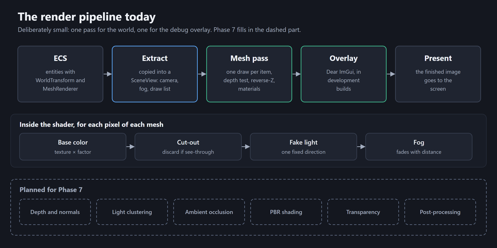
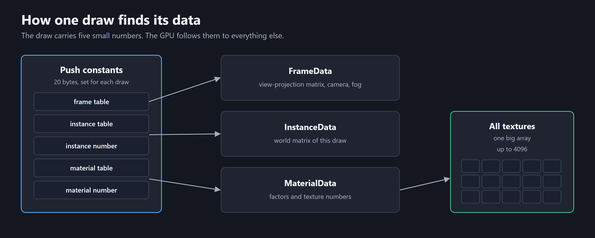

# From entity to pixel

*Inside the engine: short posts about one part of Daidalos Engine Next.*

The render pipeline is the path that turns a list of objects into an image. Mine is very short today, and I'd rather show it as it is than as it will be.

The first step is the important one. The renderer never reads game data. Each frame, **extraction** copies what's needed into a `SceneView`: a camera, the fog, the flashlight and a list of draws. That copy is the only thing the renderer sees, which keeps gameplay and Vulkan apart.

The **mesh pass** then draws each item. Every draw is tested against a **depth buffer**, which keeps near surfaces in front of far ones. Mine is **reverse-Z**, which stores depth backwards because that keeps its precision much more even with distance.

## How a draw finds its data

Older APIs make you bind each texture before each draw. The new engine is **bindless**: every texture lives in one big array that the GPU can always see, and a draw only sends numbers.

Five integers go with each draw, in what Vulkan calls **push constants**. The shader uses them to find the matrices and the material, and the material gives the numbers of its textures. So changing a material costs nothing more than changing a number.

The CPU can be preparing a frame while the GPU is still drawing the last one. To avoid writing over data in use, the frame and instance tables exist twice, once per frame in flight.

## What it can't do yet

- The light is mostly fake: one fixed direction, the fog that makes the factory dark, and a single shadowless spot for the flashlight.
- Every object is drawn, even those behind you. Nothing culls.
- See-through materials are drawn opaque.
- Materials already store everything needed for realistic shading, but only the base color is used.

Those gaps are for Phase 7. The plan there is clustered forward rendering, which cuts the view into small cells, with a list of the lights that touch each one.
