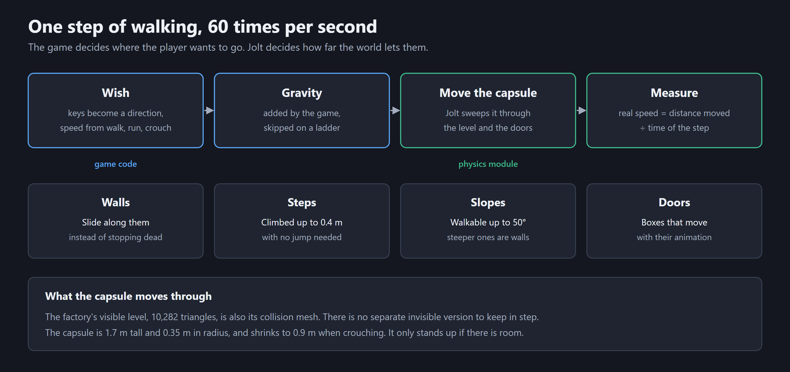

# How the player walks

*Inside the engine: short posts about one part of Daidalos Engine Next.*

Collision in a shooter isn't really a physics problem. A falling crate should obey physics. A player should stop instantly, turn on a coin and never bounce off a door frame. So the player in my engine isn't a physical object pushed by forces.

The physics library is **Jolt**, and it offers a **virtual character**: a capsule that is moved directly, on request. Each step, the game says where the player would like to go, and Jolt answers with where they actually end up.

The split in the diagram matters. The game owns the speed, and gravity too, because a player on a ladder has none. Jolt owns the geometry: sliding along walls, climbing steps, staying on slopes. That's why the game code stays small.

## Doors

Doors are **kinematic bodies**: boxes that the physics simulation doesn't push around, moved by the game. The box comes from the size of the door's model and follows its animation at each step, so a half-open door blocks the part of the doorway it still covers.

## A bug worth telling

An automated test caught a jump that kept pushing against a ceiling. Jolt remembers the speed it was asked for, not the speed the character really reached. The fix was to measure the real speed from the distance moved. It's the last box in the top row of the diagram.

## Measured in the real game

A script pressed real keys in the running sandbox, then read the player's position back:

| | Measured |
|---|---|
| Walking | 3.5 m/s |
| Crouching | 2.1 m/s |
| Running | about 5.9 m/s, with a door slowing that run down |
| Jump height | 0.86 m, for 0.875 m expected |

The automatic door opened and let the player through. The red door and the hand-operated door blocked the way. Ladders worked up and down.

## What isn't done

- Rays pass through characters, so bullets can't hit a zombie this way. That has to be solved for combat.
- The numbers above say nothing about how it feels. I kept the old game's values, and the feel still needs a real play-through.

[TO WRITE: how it feels to walk through the factory, once I've played it.]
