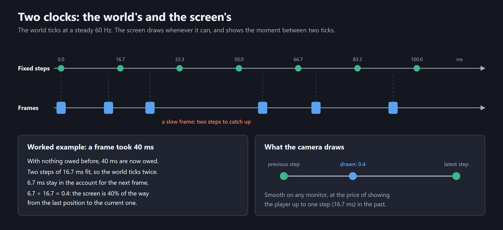

# Two clocks

*Inside the engine: short posts about one part of Daidalos Engine Next.*

Your screen might show 60, 144 or 37 images per second, and that number changes from one moment to the next. If the game's physics followed it, a jump could reach a different height on a different computer.

So the engine has two clocks.

The **world** always advances by exactly 1/60 of a second. The **screen** draws whenever it's ready. Between the two sits a small account: each frame deposits the time that really passed, and the world withdraws 16.7 ms for each step it can pay for. A slow frame gets two steps, and a fast one may get none.

What's left in the account is the useful part. In the example, 6.7 ms remain, which is 40% of a step. The screen therefore draws the player 40% of the way between their last two positions. This is **interpolation**, and it keeps movement smooth even on a monitor that doesn't match 60 Hz.

## The small print

- **The picture runs slightly behind.** Interpolating between two known positions means showing the player up to one step in the past. That's 16.7 ms at most.
- **Key presses need care.** A press lasts one frame, and a frame may contain no fixed step, so a jump could get lost. The player keeps such presses until the next step uses them.
- **Very long pauses are cut.** A frame counts for 0.25 s at most, so a freeze can't trigger a long burst of catch-up steps.
- **The mouse stays on the frame clock.** Looking around happens on every frame, because a delay there would be felt at once.

The old engine had something close to this idea, and I compare the two in a later post about collision.
