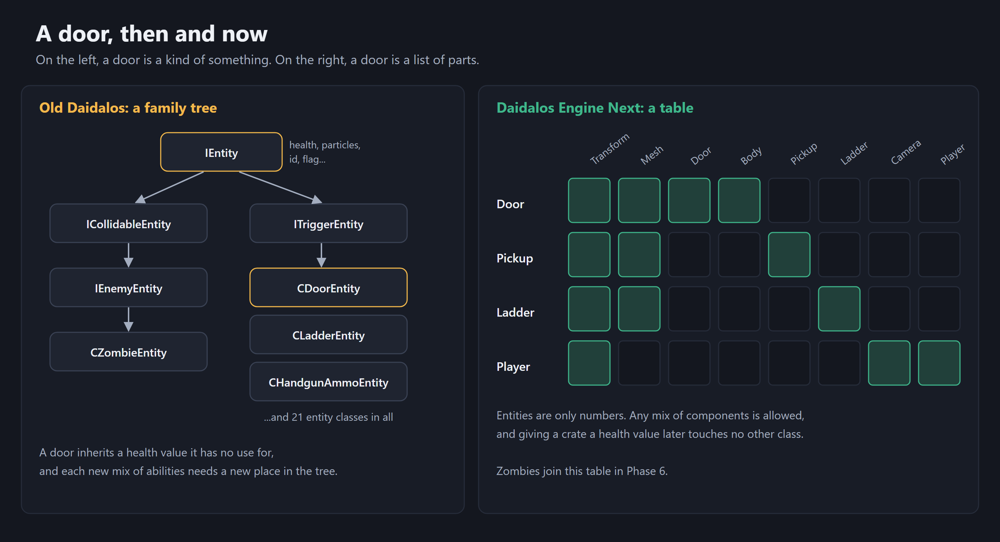

# The door, then and now

*Then and now: one small part of my old engine next to the new one.*

Both versions of Daidalos have the same door, in the same factory. They describe it in very different ways.

## Then: a family tree

The old engine used inheritance, as many engines did. `CDoorEntity` is an `ITriggerEntity`, which is an `IEntity`. A zombie is a `CZombieEntity`, then an `IEnemyEntity`, then an `ICollidableEntity`, then an `IEntity`. The game has 21 of these classes.

It reads well, and each class holds its whole behavior in one place. But the base class gathers everything that several children need. `IEntity` holds health, so every door has a health value it doesn't use. The objects drawn on screen also lived in a second tree of scene nodes, each of which stored eight matrices.

## Now: a table

In the new engine, a door is a number with a position, a mesh, a `Door` component and a collision body. A pickup has a position, a mesh and a `Pickup`. There's no tree of kinds, only rows and columns.

The `Door` component is also just data: its id, whether it's locked, and so on. The behavior lives in a system, which is one function for all doors.

## What I gave up

The old version wins on one point: to understand a door, you open `CDoorEntity` and it's all there. In the new engine, the data and the behavior live apart, and following one object means reading several systems.

The new version also looks simpler partly because the game is still small. The old one drives zombies with states, weapons, teleporters and security cameras. The real test comes with Phase 6, when the zombies join this table.

One thing hasn't changed: game concepts stay out of the core. In both engines, the door sits above the part that draws things.

[TO WRITE: why I built the old engine around inheritance, and what wore me out about it, if anything did.]
