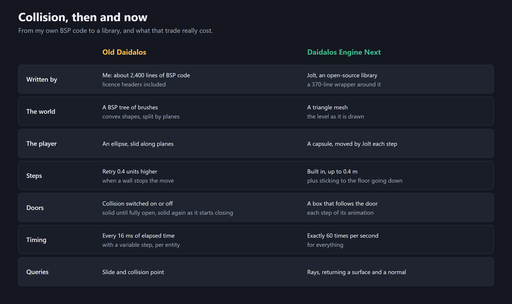

# My BSP tree and a library

*Then and now: one small part of my old engine next to the new one.*

Of all the parts of the old engine, this is the one that changed the most.

## Then

The old level was stored in a **BSP tree**, a structure that recursively cuts space in two with planes. The same technique goes back to the Doom and Quake era that inspired the demo. It answered two questions: what's visible, and what's in the way.

The player was an ellipse, slid along the level with a loop of up to five impacts. On each impact, it recorded the surface, removed the part of the movement going into it, and tried again. Steps used a simple trick: when a wall stopped the player, the same move was tested again 0.4 units higher, and kept if it went further.

Doors show the limit of that design. A door's collision was a switch: solid until it had finished opening, and solid again as soon as it started to close. My old to-do list has an unfinished plan for adding moving objects to the tree.

## Now

The level is a plain triangle mesh, the same 10,282 triangles that are drawn. Jolt handles the rest, behind a wrapper of 370 lines. A door is a box that really moves.

The timing changed as well. Old collisions ran every 16 ms of elapsed time, with a step that followed the frame rate. Now everything runs in exact steps of 1/60 s. My old to-do list mentions a collision bug at low frame rates. The code alone can't tell me whether this was the cause, but that kind of bug has less room to exist now.

## What the trade cost

About 2,400 lines of hand-written BSP code became 370, and that isn't a fair count. The complexity didn't disappear: it moved into Jolt, a far larger library that I didn't write and don't fully know. When Jolt surprises me, as it did with the ceiling bug from [How the player walks](010-how-the-player-walks.md), I have to learn its rules instead of reading my own code.

Visibility also went with the BSP tree. The old engine could skip what you can't see, and the new one doesn't cull anything yet. The plan is bounding volumes first, and anything fancier only if measurements justify it.

With about three hours a week, I think it's the right trade.

BSP trees have been with Daidalos from the start. The very first version, in 2008, already had one, in OpenGL and without shaders, and I wrote it myself, like everything else in it. The old engine kept the idea: each scene cut into convex zones, and a binary tree saying what is solid and what isn't. It's the technique of Doom, Quake and Half-Life, games set indoors where nothing gets destroyed, which is exactly what Daidalos is.

[TO WRITE: what it was like to write that BSP code, and how it feels to leave it behind.]

[TO WRITE: anything from the old collision that I miss.]
