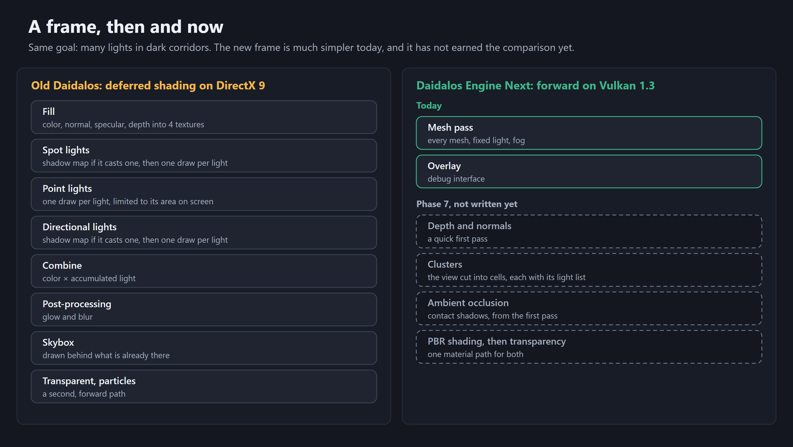

# A frame, then and now

*Then and now: one small part of my old engine next to the new one.*

This comparison has to start with an admission: the old renderer does much more than the new one today.

## Then: deferred shading on DirectX 9

The old engine first wrote each pixel's color, normal, specular value and depth into four textures, together often called a G-buffer. Lighting came afterwards: each light was one more draw, limited to its area of the screen, reading those textures and adding its light. The scene could hold up to 200 active lights of each kind, and lights that cast shadows rendered their own shadow map.

Then came combining, glow and blur, the skybox, and a separate forward path for transparency and particles. All of that sat behind an `IRenderer` interface with a single implementation, on an API that only runs on Windows.

## Now: a forward renderer on Vulkan 1.3

Today, there are two passes. There are no real lights, no shadows and no post-processing, and the darkness of the factory comes from fog. On looks alone, the old engine wins easily for now.

The difference is in the foundations:

- **Vulkan runs on Windows and Linux**, so one renderer covers both.
- **There's no interface waiting for a second backend.** The rendering layer is made of plain classes.
- **State is explicit.** The old `SetTexture` and `SetRenderState` calls changed global settings that the next draw inherited. In Vulkan, a pipeline fixes that state up front, and a draw only passes numbers.

## Why not deferred again?

Deferred shading handles many lights well, and the old engine did exactly that. Its weak point shows in the diagram: transparency needs a whole second path, and every material has to fit into the same few textures.

The Phase 7 plan is **clustered forward**: the view is cut into small cells, each cell lists the lights that touch it, and each surface shades itself with its cell's list. It offers many lights with one material path. If I want effects that need a G-buffer, I'll reconsider.

That's still a plan. None of it exists yet, and it won't have earned this comparison until it runs in the factory with real lights.

The old renderer came out of my university classes on DirectX 9 and shaders, in 2010. Daidalos DX was where I put them to use: dynamic lights, soft shadows, normal mapping. The very first render with lighting and shadows had a turning fan in it, throwing its moving shadow on the room. Then came bars, because light running through bars looks good, and the bonus items, which were what I tested specular highlights on. The engine that followed drew each object once per light with HLSL 3.0 shaders, added a deferred path for scenes with many lights, a flashlight that cast shadows, and alarms that swept red light through the bars, the pillars and the crates.

[TO WRITE: which effect from the old renderer I most want back.]
