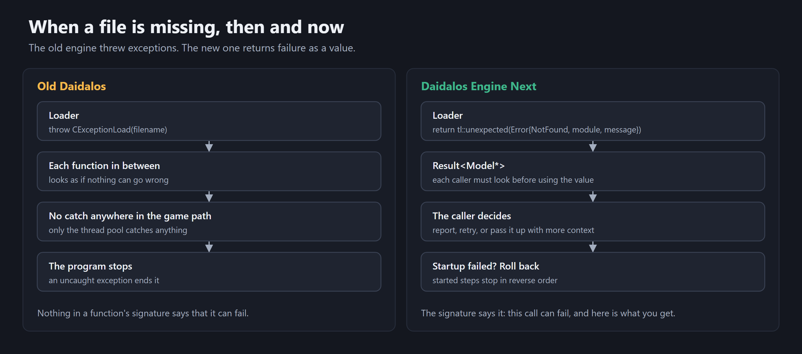

# When a file is missing

*Then and now: one small part of my old engine next to the new one.*

Error handling is an unglamorous topic, and it shows how a codebase thinks. So here's one question for both engines: what happens when a file is missing?



## Then: exceptions

The old engine had a family of exception classes and 34 `throw` statements in its core. The matching `catch` statements are easy to count: across the engine, the game layer and the game itself, there's exactly one, inside the thread pool. In practice, a failed load ended the program.

The media manager also has this line:

```cpp
throw new CExceptionLoad(filename);
```

The `new` means that it throws a pointer rather than an object, unlike the loaders, which throw the object directly. A handler written for one wouldn't catch the other. With no handlers in the way, it never mattered, which is exactly how such a slip survives.

## Now: failure is a value

A function that can fail now says so in its return type:

```cpp
core::Result<const Model*> LoadModel(std::string_view path);
```

A `Result` holds either the value or an `Error`, with a code, the module's name and a message. The caller has to go through it to reach the value, and the error path is plain code that tests can reach. A missing file in a level is reported with its name.

Programming mistakes are a different case and use `DAI_ASSERT`, which stops the program. Bad input is expected and handled. A broken rule of the code itself is a bug.

Startup uses the same idea. If any step fails, the steps already started are stopped in reverse order, so nothing runs half-initialized.

## What it costs

It's more verbose. Failures have to be passed along by hand, level after level, where an exception would simply fly past. In a long sequence of calls, a good part of the code ends up being about errors.

Exceptions are still enabled, because some third-party code throws, but none may cross a module boundary.

I'll take that verbosity. Errors now travel through code I can read, and they can be tested.
