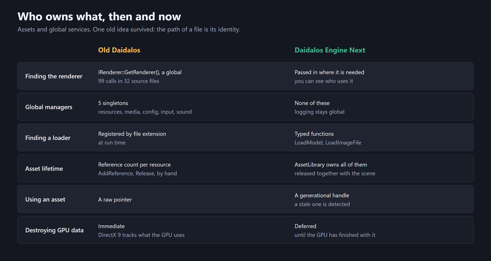

# Who owns this texture?

*Then and now: one small part of my old engine next to the new one.*

Every engine has to answer a dull question that decides a lot: who is responsible for this object, and when does it go away?

## Then: global, and counted

Five managers were singletons: resources, media loading, configuration, input and sound. The renderer was a global too, reached with `IRenderer::GetRenderer()` 99 times across 32 source files. That's convenient, since any code can do anything from anywhere. It also means that nothing tells you what a class really depends on, and those objects have to live and die in the right order.

Resources were **reference counted**: each user called `AddReference`, each user called `Release`, and the last one out deleted the resource. One missing call means a leak, and one call too many means something disappears while still in use.

Loaders were chosen at run time from a file's extension, through a registry of templates.

## Now: owned, and released together

The renderer is passed to whatever needs it, so a function's parameters show its dependencies. An `AssetLibrary`, owned by the scene, holds everything loaded for that scene and releases it all at once. Nothing is counted, because scene assets arrive together and leave together.

Loading uses plain typed functions, since the engine knows all its asset types when it's compiled.

Everyone else holds a handle, which detects a destroyed object, as described in [The handle that knows its object is gone](008-the-handle-that-knows-its-object-is-gone.md).

Destruction also changed, because Vulkan requires it. DirectX 9 keeps track of what the GPU is using for you. Vulkan doesn't. So a destroyed object is only released once the GPU has really finished with it.

## What didn't change

One old idea survived. In the old engine, a resource was found by its name. In the new one, an asset's identity is its path, cleaned up so that two spellings of the same file are one asset.

## The limits

Releasing everything at once only works while assets belong to a whole scene. An open world streaming pieces in and out would need something else, but this engine is built for corridors and rooms, so I chose the simple option.

Not everything global is gone either: logging is still reachable from anywhere, because passing a logger through every function would help no one.
