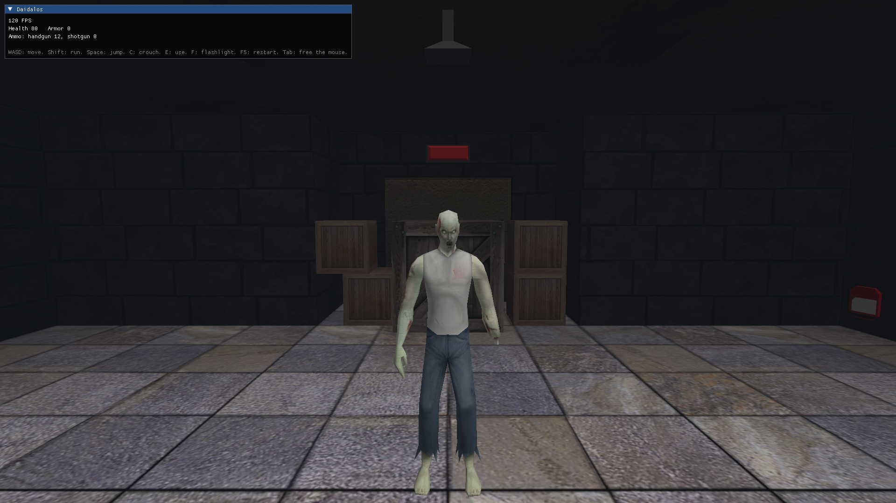
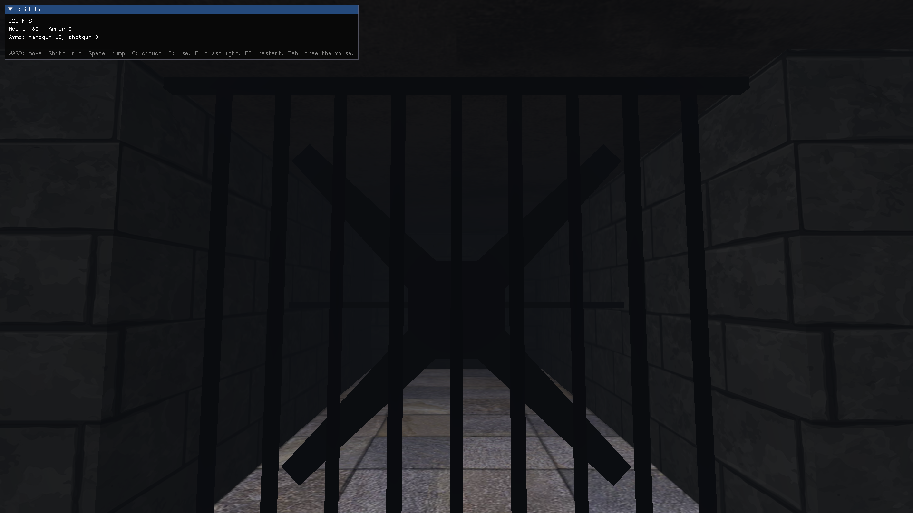
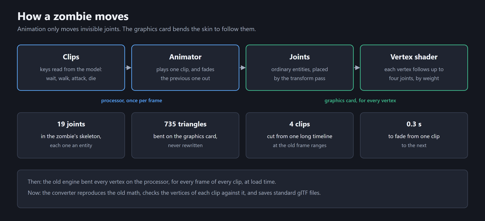

# The zombies wake up

The zombies of the old factory are back, and they move. They wait, turn to face you when you come within 12 meters, and swing at you when you get too close. The ventilation fans turn again too.

[TO WRITE: what it was like to see the old zombie move in the new engine.]

*A zombie of the old demo in the new engine, at the end of step 6.3.*

*One of the fans, turning again behind its grille.*

## Skeletons and skins

Characters are animated the way most games do it, with **skeletal animation**. A zombie has an invisible skeleton of 19 **joints**: hips, spine, arms, legs. An animation only moves the joints, and each vertex of the body follows the joints it belongs to, a little like skin over bones.

Two choices make it simple:

- **Joints are ordinary entities.** The engine already turns every node of a model into an entity with a position, so a joint is just one more. Animation writes their positions, and the rest of the engine does what it always did. Later, putting a weapon in a zombie's hand will be as easy as attaching it to the hand's entity.
- **The skin bends on the graphics card.** Each vertex knows up to four joints and how much each one counts. The graphics card mixes their movements as it draws the vertex, so the model's data never changes.

When a zombie switches from waiting to attacking, the new clip doesn't cut in. The old one fades out over 0.3 seconds, and the engine blends the two poses joint by joint.

## Bringing the old models over

The old models are in the MilkShape 3D format, and all their clips sit on one long timeline. The old game code knew that the walk was frames 22 to 36, played at 8 frames per second, and the death frames 91 to 103.

The conversion script now turns them into standard **glTF** files, the format the engine already reads, with each frame range cut into a named clip: `wait`, `walk`, `attack` and `die` for the zombie, `fire` and `reload` for the handgun, `spin` for the fans.

The tricky part was the math. The old engine had its own conventions for rotations and matrices, and the new engine uses others. Rather than work out the conversion on paper, Claude Code, my development assistant, ported the old engine's quaternion and matrix code line by line into the script. For one frame of each clip, the script computes where the old engine put every vertex and where the new data puts it, and it stops if any vertex is off by more than a tenth of a millimeter. None is.

## The numbers

| | |
|---|---|
| Automated tests | 456, up from 426 |
| New module | `animation`, the fifteenth |
| Zombie | 19 joints, 735 triangles, 4 clips, 1.52 m tall |
| Loading the zombie and fan models | about 10 ms together |

The tests check the clips' math on the processor, and check on a real graphics card that a skinned shape lands where its joints say.

## What isn't done

- **The zombies don't walk anywhere.** They only turn and strike. Hunting the player, taking damage and dying come with the weapons, in the next step.
- **Every joint is computed every frame**, even for a zombie behind three walls. That's fine for the four zombies of the level, and culling will fix it in a later phase.
- **The Linux build is unchecked.** The automated build machines are paused, so this phase was only tested on Windows.

## Next

Phase 6.4: the handgun and the shotgun, and zombies that hunt you down.
