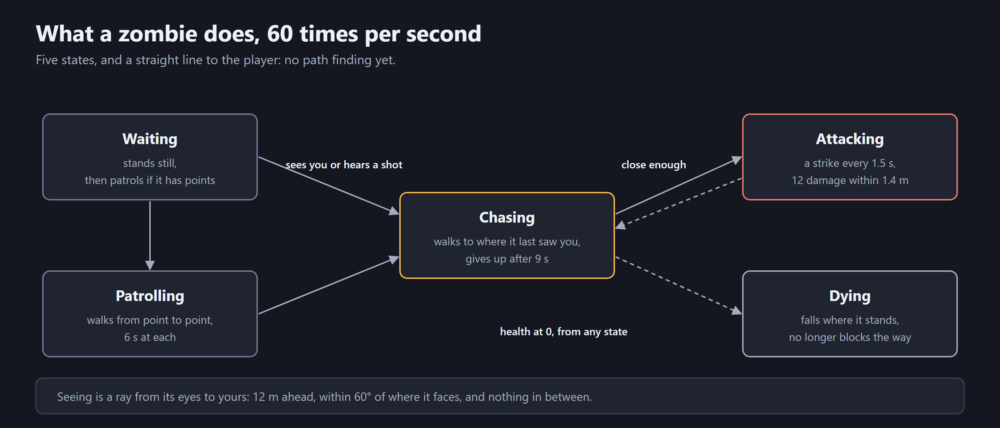

# Fighting back

The factory's zombies now hunt you, and you can shoot back. That closes Phase 6: the rebuilt demo can be walked through, heard, and fought in.

[TO WRITE: the first fight against a zombie in the new engine.]

*No screenshot yet, for the same reason as last time: the textures are free assets whose licences I still have to find.*

## Two weapons

The **handgun** keeps the old game's numbers: 12 rounds, 10 damage, a shot every 0.35 seconds. Reloading is a bit quicker than in the original. The **shotgun** fires 5 pellets of 12 damage, enough to drop a zombie at close range.

The old game had a shotgun in its code, and shotgun shells in this level, but no shotgun anywhere to pick up, and no model for it. Claude Code, my development assistant, wrote a small script that builds one out of boxes and cylinders, with a pump that slides when you fire and reload. It now lies next to the shells.

Shots are **rays**: an invisible line from your eyes, slightly scattered the way the old game scattered its bullets, that stops at the first thing it touches. To make that work, the physics module had to change: until now, rays went straight through characters. Each character now carries an invisible capsule that rays can hit, but that doesn't get in anyone's way.

## Zombies that hunt

A zombie waits, or walks its patrol. It notices you if it can *see* you, with a ray from its eyes to yours, or if it *hears* a shot within 20 meters. Then it comes straight at you, strikes when close enough, and looks for you for 9 seconds if you get away.

"Straight at you" is the honest limit: there is no path finding yet, so a zombie can't walk around a wall. When one keeps walking into a wall, it gives up on that spot instead of pushing forever.

## What testing found

- **Zombies were far too deadly.** In the first automated test fight, one took the player from 80 health to 0 in about 5 seconds: 12 damage every 0.8 seconds. The old game waited for the strike's 1.5 s animation to finish before the next one, so now a strike takes that long too.
- **The level has a one-sided wall.** In another test, a zombie stopped 2.4 meters from the player, and the shots never reached it. The logs showed every shot hitting an invisible wall: it faces away from that side, so it isn't drawn from there, but it still blocks. That wall belongs to the level, and the game was right.
- **A spinning shotgun.** The shotgun in the player's hands lay sideways. Its model has a part named "shotgun", and the code that reads the level's names took it for the shotgun pickup, which spins. Weapons are now set up after the level's names are read.

## The numbers

| | |
|---|---|
| Automated tests | 462, up from 456 |
| Zombie health | 50: 5 handgun hits, or one close shotgun blast |
| Zombie speed | 1.3 m/s, up from the original's 0.7 |
| Shotgun model | 240 triangles, 2 clips |

## What isn't done

- **No path finding**: zombies can only reach you in a straight line.
- **No muzzle flash, smoke or blood**: those wait for the particles of Phase 7.
- **The HUD and crosshair are the debug overlay**, which only exists in development builds. The game's own HUD comes in Phase 8.
- **The weapons can poke into walls** when you stand right against one.
- **The Linux build is still unchecked**, as the automated build machines are paused.

## Next

Phase 7: real lights in place of the fog, shadows for the flashlight, and particles.
