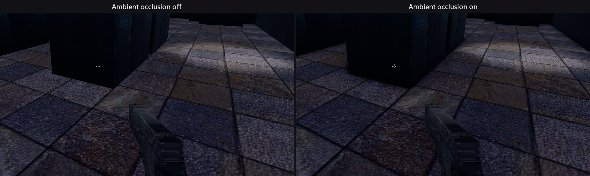

# Corners and creases

This part of Phase 7 is less spectacular than lamps and shadows, but it changes how solid the factory feels: corners darken, floors catch more light than ceilings, and the engine got faster at the same time.

[TO WRITE: what I noticed first when walking through the factory with these changes.]

*The same spot with ambient occlusion off and on (`renderer.ambient_occlusion`), at the end of step 7.3. Look at the foot of the lockers.*

## Light from above

Away from the lamps, the factory is lit by a faint light that comes from everywhere. Until now it came equally from every direction, so a wall looked the same whichever way it faced, and my normal maps vanished as soon as you left a lamp's pool.

Now that light comes more from above, where the lamps are, than from the floor. Floors are a little brighter, ceilings a little darker, and the top edge of each brick catches the light, so the mortar lines read as grooves even in the dark.

## Darker corners

Where two surfaces meet, less light can reach: a corner is darker than the middle of a wall. Real rooms look like that, and rooms without it look flat. The engine now computes this "ambient occlusion" every frame from what's on screen: for each pixel, it checks sixteen points around it, and darkens it by how many are buried in nearby geometry. In the start room, corners darken to about 80% of their brightness, and open walls keep all of theirs.

A setting turns it off, `renderer.ambient_occlusion false`, for slower machines or to compare.

## Doing less work per pixel

Two changes make the rest cheaper:

- **A first pass that only records depth.** Before shading anything, the engine draws the whole scene once, writing only how far each pixel is. The real pass then shades each pixel once, instead of shading surfaces that something nearer covers anyway.
- **Light clusters.** The view is cut into 3,456 boxes (16 across, 9 down, 24 in depth), and each box gets the list of lights that reach it. A pixel only looks at the lights of its box, instead of every light in the level. With fourteen lights it barely matters yet, but it will once levels have dozens.

The second one was checked the way it should be: on 20,000 random points of the view, every light that reaches a point must be in that point's list. The first version of that test failed. The failures were all points outside the screen, which are never drawn, so the test was wrong, not the clusters. It now checks only what you can see, and passes.

## The numbers

| | |
|---|---|
| Light clusters | 16 × 9 × 24 = 3,456 |
| Shading pass | 0.37 to 0.68 ms, down from 0.74 to 1.40 ms |
| Depth pre-pass and ambient occlusion | 0.18 to 0.29 ms and 0.31 to 0.35 ms |
| Whole frame on the GPU | about the same as before, with ambient occlusion added |
| Automated tests | 474, up from 468 |

All at 1280×720 on an RTX 3090, in a release build.

## What isn't done

- **Ambient occlusion only knows what's on screen**: something behind you doesn't darken the wall in front of you.
- **Lights are sorted into clusters on the processor, not the graphics card.** That's plenty for this level; it can move later.

## Next

Particles, computed on the graphics card: smoke, sparks, blood, and the old level's green fog.
