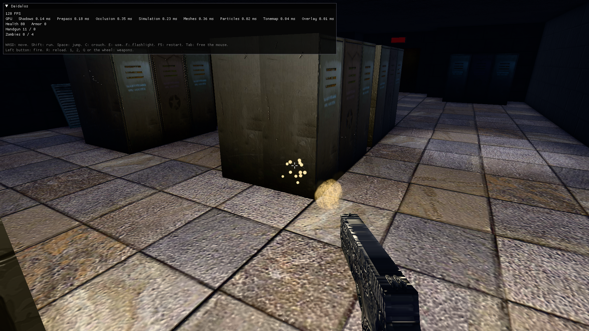
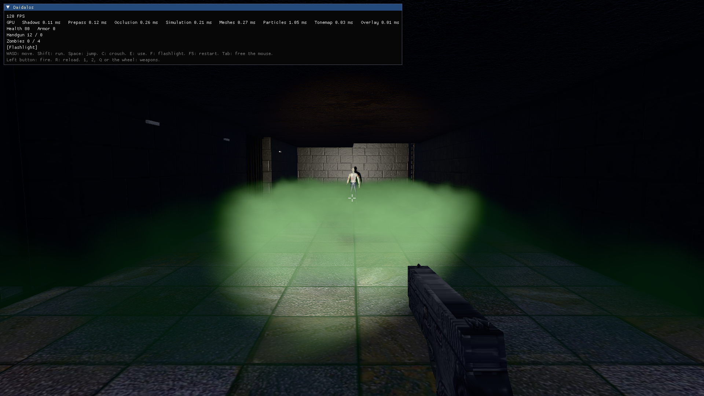

# Smoke and sparks

The factory has particles again. Smoke leaks from a pipe, green fog hangs over the toxic area, and every shot now has a flash at the muzzle, a wisp of smoke, and sparks where the bullet hits, or blood on a zombie. This time the graphics card does the work, not the processor.

[TO WRITE: what the particles were like in the 2011 engine, and how it felt to see the old smoke leak again.]

*A shot: the muzzle flash lights the room, and sparks fly where the bullet hits. End of step 7.4.*

*The green fog of the toxic area, in the flashlight's beam.*

## The old effects, rebuilt

The 2011 engine described its effects in a template file: how many particles per second, how long they live, their colors at birth and at death, their size, their speed. The new engine reads none of that file, but I carried the values over by hand, converted to meters and seconds. The level's emitters keep their old names, such as `smokeLeakEmitter`, and the game maps each one to its effect.

The images are the same too: one texture split into a grid of sixteen cells, which I made for the original game. It's now part of the repository.

## Everything on the graphics card

Particles used to live in the processor's memory: each frame, the engine moved every one of them, then sent them all to the graphics card. Now they never leave it. The processor only sends small requests, such as "12 smoke particles here, turned this way", and the graphics card does the rest, in four steps:

1. **Birth.** Each new particle takes a free slot from a list of 16,384.
2. **Movement.** Gravity, air resistance and spin. Particles that should bounce, like sparks and blood, check the depth of what's on screen: if one goes behind a wall, it's pushed back out and bounces off it.
3. **Sorting.** Smoke has to be drawn from back to front, or nearer puffs would be covered by farther ones. The graphics card sorts every particle by distance, every frame.
4. **Drawing.** One draw call for all of them, with a count that the graphics card itself wrote. The processor doesn't even know how many particles there are.

A few touches make them blend into the scene: smoke fades where it meets a wall instead of cutting through it, takes the color of the lamps around it, and fades in when it's born. Sparks and flashes add light instead of covering what's behind them, in the same draw call as the smoke.

## Two things I got wrong first

**The sort was slow.** The first version sorted in 105 small steps, each waiting for the previous one to finish, and took over a millisecond. Now each group of threads sorts 2,048 particles in its own fast memory, and only the longer steps run separately: 10 steps instead of 105.

**The first smoke looked like a dark wall.** Too many particles, too dark, piled up in a narrow corridor: two hundred puffs, one behind the other, add up to something solid. A black octagon in the middle made it look like a bug in the drawing. To be sure, I drew one particle alone, unlit and opaque. It came out right, and the octagon behind it was the pipe's opening in the level, which the smoke comes out of. Fewer puffs, a lighter color and a fade-in fixed the rest.

## The numbers

| | |
|---|---|
| Particles alive at once | up to 16,384 |
| Movement and sorting | 0.33 to 0.55 ms, whatever the number of particles |
| Drawing | 0.01 ms, up to 0.5 ms inside the toxic fog |
| Sorting steps | 10, down from 105 |
| Automated tests | 485, up from 474 |

All at 1280×720 on an RTX 3090, in a release build.

## What isn't done

- **Particles only bounce off what's on screen**: behind you, sparks go through walls.
- **Smoke is lit evenly from every side**, and it neither casts nor receives shadows.

## Next

That's the last part of Phase 7. Phase 8 is the game's own interface: the in-game display, the crosshair, the menus and a loading screen.
