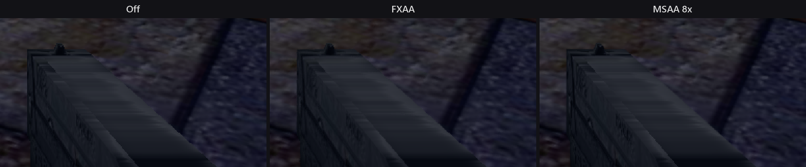

# Settings, and smoother edges

Until now, every setting of the engine lived in the demo's own file. That worked for one game, but each new one would have had to copy it. Now the engine has a settings file of its own, `daidalos.cfg`, which every program built with it reads, and a game only adds a small file for what is its own. I also added the settings players look for first: shadows, antialiasing, view distance and field of view.

[TO WRITE: which of these settings I change first in a game, and what I set them to.]



*The edge of the handgun with antialiasing off, FXAA and MSAA 8x, enlarged 2.5 times without smoothing.*

## One file for the engine

The file is plain text, one setting per line, with a comment above each one saying what it does and what values it takes:

```text
# Smoothing of jagged edges: off; fxaa, ...; or msaa2, msaa4 or msaa8, ...
renderer.antialiasing fxaa
```

The build puts a copy next to the program the first time, and never touches it again, so your changes stay. The demo's own file now only holds the demo's settings, such as how dark the factory is. Anything can still be set on the command line, which wins over both files.

## The new settings

- **Shadows.** How many lamps cast shadows, from none to sixteen, and how sharp they are. Before, it was always four.
- **Field of view.** Given across the screen, in degrees, as most games show it: 90 by default. A wider window sees more to the sides, not less above and below.
- **View distance.** Nothing farther is drawn or lit: 150 meters by default, more than the factory's fog lets you see.
- **Fullscreen.** The window covers the whole screen, at the screen's own resolution.
- **Antialiasing,** below.

Most of them change while the game runs; the shadow settings need a restart.

## Smoother edges, two ways

A screen is a grid of pixels, so the edge of a wall that is not perfectly straight comes out as a staircase. Antialiasing smooths it. The engine now has the two classic ways:

- **FXAA** works on the finished image. It looks for places where brightness jumps, follows each edge to both its ends, and blends the pixels across it according to where they sit along it. It's cheap, 0.02 ms here, and handles every kind of edge, but it also softens textures slightly.
- **MSAA** works while drawing. Each pixel is tested at 2, 4 or 8 points instead of one, so a pixel half covered by a wall gets half its color. Textures stay sharp, but it only smooths the edges of geometry, and it costs more: about 0.1 ms with 8 samples.

FXAA is the default. To be sure it really smooths edges, an automated test draws a jagged slope and checks that pixels along it now blend, while flat areas stay untouched. With FXAA switched off in the shader, that test fails, as it should.

MSAA needed new support at the lowest level of the engine, where it talks to the graphics card: images with several samples per pixel, and a way to merge them back into a normal image at the end of a pass. The first test of that merge failed: every pixel came out half white. Printing the image showed why: the merge was right, and the triangle's edge ran exactly through the pixels the test checked, which correctly came out half covered. The test was moved off the edge.

## The numbers

| | |
|---|---|
| FXAA | 0.02 ms |
| MSAA, 4 and 8 samples | about 0.08 and 0.10 ms more |
| Shadowed lamps | 0 to 16, 4 by default |
| Automated tests | 496, up from 485 |

All at 1280×720 on an RTX 3090, in a release build.

## What isn't done

- **The view distance cuts the scene sharply** where fog doesn't hide it.
- **A very wide field of view stretches the weapon** in your hands, which games usually draw with a field of view of its own.
- **MSAA doesn't smooth see-through cut-outs**, like grates, only the edges of geometry.

## Next

Phase 8: the game's own interface, with the in-game display, the crosshair, menus and a loading screen.
