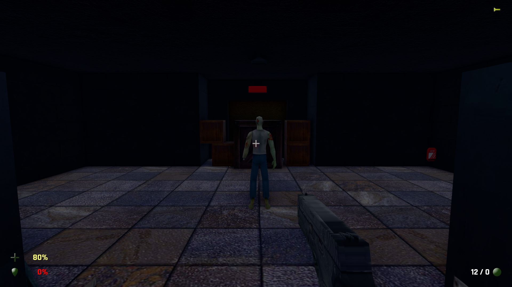

# A HUD of its own

Until now, the demo's health, ammunition and crosshair were drawn by the engine's debugging tool. That worked while I played in development builds, but a build without the developer tools had no HUD at all, and it looked like a debugger rather than a game. Now the engine has a small interface layer of its own. The demo's HUD is back to the layout of the original Daidalos, with my old icons, and it shows in every build.

[TO WRITE: what the original HUD meant to me, or a memory of making hud.png.]

*The new HUD, in a build without the developer tools, at the end of step 8.1.*

## Drawing like a painter, every frame

Game code draws the interface again every frame, in order, like a painter: a rectangle here, an image there, a line of text. Nothing is kept between frames, so there is no tree of widgets to keep in step with the game. If the player has 80 health this frame, the HUD writes 80 this frame.

Positions are given as if the screen were always 1080 pixels high, and the engine scales them to the real window. The old engine's HUD was laid out for a 1920×1080 screen, so its positions carried over as they were.

The interface is drawn last, over the finished image: after the antialiasing, which would otherwise blur the text, and under the developer overlay.

## Letters that stay sharp at any size

The old engine used pictures of Arial at fixed sizes. Scaled, they went blurry or blocky. And Arial belongs to Microsoft, so I can't share those pictures.

The new font is Rajdhani, a free font under the SIL Open Font License, and the engine doesn't store pictures of its letters. When it loads the font, it computes a **distance field** for each letter: every pixel holds how far it is from the letter's outline, inside or outside. When drawing, the graphics card reads that distance and keeps what is inside the outline, with a soft edge one screen pixel wide. The same 512×512 image serves every size, from a small message to a big "LOADING...".

French accents are included, and a missing character shows as a question mark rather than nothing.

## The old layout, with a few additions

As in the original: health and armor at the bottom left, in red when low, then yellow, then green; ammunition at the bottom right; the flashlight icon at the top right; the crosshair in the middle. New: the flashlight icon dims when the light is off, the red card shows once you have it, messages fade out instead of vanishing, and "RELOADING" appears above the ammunition.

## How it's tested

Automated tests check the font (letters are inside in the middle of a stroke and outside at the edges, accents are there) and the layout of text: alignment, several lines, missing characters. Others draw on the graphics card and read the pixels back: a red rectangle comes out exactly red, half-transparent white over black comes out at the right brightness, and a letter covers exactly where its distance field says it's inside. Then I checked the real HUD in the running demo, zoomed in on the numbers.

## The numbers

| | |
|---|---|
| Interface on the graphics card | under 0.01 ms |
| Loading a font | 80 to 95 ms, once at startup |
| Letters in a font | 188, in a 512×512 image |
| Automated tests | 524, up from 496 |

At 1280×720 on an RTX 3090, in a release build.

## What isn't done

- **Very small text loses detail,** since one image serves every size. The HUD never goes that small.
- **The font loads on the main thread,** so startup takes about 0.2 s longer for the two weights.
- **No kerning in practice:** the engine supports it, but Rajdhani has none.

## Next

Phase 8.2: menus, a pause screen, options that save, and a real loading screen with the old turning gear.
