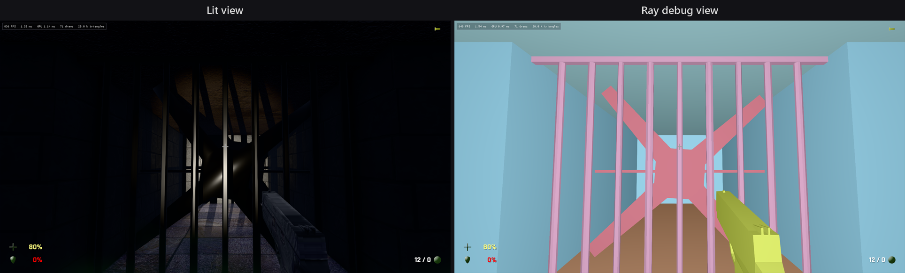

# What rays see

Tracing a ray means finding the first triangle it meets. Testing every triangle of the level for every ray would take forever, so graphics cards search a tree of boxes instead: a box around the whole level, smaller boxes inside it, down to a few triangles each. These trees are called acceleration structures, and step 3 of the ray tracing phase builds them. Still nothing traces a ray for the game itself, but there's finally something to trace against.

[TO WRITE: how levels were found by rays, or by anything else, in the original engine.]

## Two levels

There are two kinds of tree. Each mesh gets its own, built once when the mesh is loaded: 58 of them for the factory. A second tree, built again every frame, places those meshes in the world: one entry per object drawn, with its position, whether its material lets light through holes (the grids), and whether the first-person weapon belongs to it, so that the weapon won't cast shadows over the level later.

The whole factory takes 1.7 MB of these trees. Graphics cards can also compact them, which saves memory but takes a round trip through the processor. At 1.7 MB, I left that for later.

## The trouble with animated characters

A zombie's mesh changes shape every frame, so its tree can't be built once. Until now the engine didn't even keep the animated shape anywhere: the vertex shader bent the mesh on the fly, three times per frame, once for each pass that draws it.

Now a compute shader bends each animated mesh once per frame and stores the result. Every pass draws that stored shape, and its tree is built from the same data. That matters more than it sounds. If rays and rasterization each bent the mesh themselves, rounding could put the two versions a hair apart, and in step 5 a shadow ray would hit the surface it starts from and draw dark speckles.

I planned to rebuild those trees from scratch every frame. Measured, rebuilding the seven animated meshes in the factory (zombies, fans, the weapon) took 0.197 ms. Refitting, which moves the triangles inside the boxes they already have instead of building new boxes, takes 0.049 ms. The catch is that the boxes get looser as a limb moves far from the pose it started in, so rays slow down a little. If that ever shows in a measurement, a full rebuild every few frames fixes it.

## Seeing it

To check all this, the engine has a new debug view: one ray per pixel from the camera, each object in its own color, shaded by the angle of the face it hits. Side by side with the normal view, walls, bars, lamps and the gun are in the same places, and the fan, an animated mesh, turns behind its grille.

*The same spot in the lit view and in the ray debug view, at the end of step 3. The fan turned a little between the two runs.*

## The numbers

Graphics card time, at 1280×720 on an RTX 3090, in a release build, averaged over about 30,000 frames:

| | |
|---|---|
| Bending the animated meshes | 0.011 ms |
| Refitting their trees | 0.049 ms |
| The tree of the whole scene, 71 objects | 0.095 ms |
| Memory of all trees | 1.7 MB |
| Automated tests | 576, up from 573 |

Loading the factory takes about 3.5 ms more, to build the 58 mesh trees. The rest of the frame didn't change, and screenshots of the lit factory match the previous version.

## Another correction

Two posts ago I blamed the new shader language for a slower shadow pass, and last time I took that back: I said the shadow pass was slow because it ran first in the frame. This time it didn't run first, and it still swings between 0.045 and 0.073 ms from one build to the next, with exactly the same code. So I don't know why yet. I'd rather say that than give a third explanation without proof.

## What isn't done

- **The scene tree takes 0.095 ms for 71 objects**, more than I expected. It's built for speed of building rather than speed of tracing, which may be the wrong trade once rays are cast for real. That's for step 5 to measure.
- **Linux is still unverified.**

## Next

Step 4: a reference path tracer, slow and exact, that every faster technique after it will be compared against.
