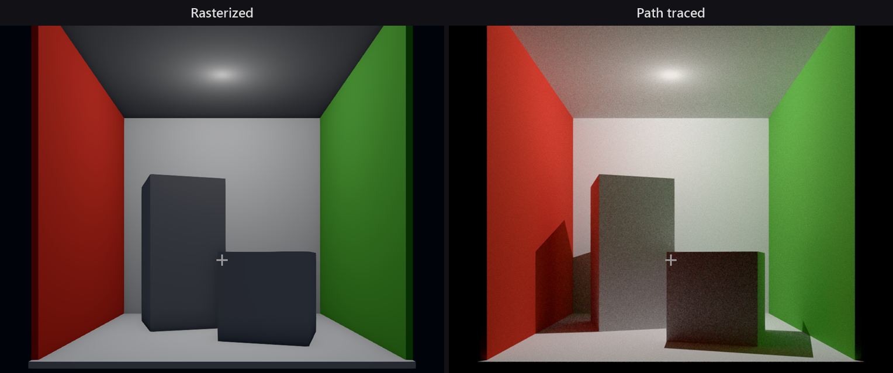

# The reference

The next steps of the ray tracing phase each replace a trick with the real thing: shadow maps with ray-traced shadows, the flat ambient light with light that bounces, and so on. Each time, I need to know whether the new image is right. Step 4 builds the answer key: a path tracer.

[TO WRITE: the first time I saw a path-traced image, or what "ground truth" meant in my earlier work.]

## Slow on purpose

A path tracer follows light the long way. For each pixel, a ray leaves the camera, hits a surface, picks a random direction according to how that material reflects light, hits something else, and so on, collecting the light it finds along the way. One such path per pixel gives a noisy image; thousands, averaged, give the right one. The engine traces one path per pixel per frame and keeps averaging while the camera stays still.

It doesn't have to be fast. It has to be right, and it has to use exactly the same materials and lights as the normal renderer, or comparing the two means nothing. So the part of the shader that says how a surface reflects light now lives in one place, a module that both the normal renderer and the path tracer use.

## How do you test a reference?

You can't compare it with itself. So the tests attack it from the side:

- **The furnace.** Put a white object under a uniformly white sky. If the material neither creates nor destroys light, the object must look exactly as bright as the sky, whatever its shape. A wrong probability or a missing factor of π shows up as an object that's too bright or too dark. The matte cube and the metal cube both pass, within the little energy that this kind of material model is known to lose at grazing angles.
- **One bounce against the normal renderer.** Limited to direct light, the path tracer must give the same image as the normal renderer, with a point light and a spotlight on a glossy cube. Away from edges, the two agree to 0.03%.
- **The Cornell box.** The classic test scene of computer graphics: a room with a red wall, a green wall and two white blocks. The test keeps a reference image and checks that later versions still match it.

## The Cornell box

The original is lit by a glowing panel in the ceiling. The engine has no lights with an area yet, so a point light hangs just under the ceiling instead. The box is also in the demo: `sandbox.scene cornell`, then switch to the path tracer. Rasterized, the faces of the blocks turned away from the light are flat and dark, lit only by the ambient light. Path traced, they catch red and green light bouncing off the walls, and their shadows are soft. That difference is what the rest of the phase is for.

*The Cornell box in the demo, rasterized and path traced, at the end of step 4.*

## The factory, honestly

Path traced, the factory is very dark. Its lamps are few and reach only a few meters; what lights most of it is a flat "ambient" light that comes from nowhere, plus the player's flashlight. The path tracer has no such light, only light that bounces. So when bounced light replaces the ambient one in step 9, the level's lighting will need work. Better to know now.

## The numbers

| | |
|---|---|
| One path per pixel at 1280×720, factory, four bounces | 0.25 ms |
| Same, one bounce | 0.03 ms |
| Same, Cornell box | 0.05 ms |
| Automated tests | 581, up from 576 |

On an RTX 3090. It's quick because most surfaces of the factory are out of reach of most lights.

## What isn't done

- **Textures are read at full detail**, because rays don't yet know how big a pixel is where they land. Distant textures shimmer in the noise.
- **Moving objects leave trails** in the averaged image: the fans keep turning while it accumulates.
- **Linux is still unverified.**

## Next

Step 5: ray-traced shadows for every light, compared with this reference, and the end of shadow maps.
