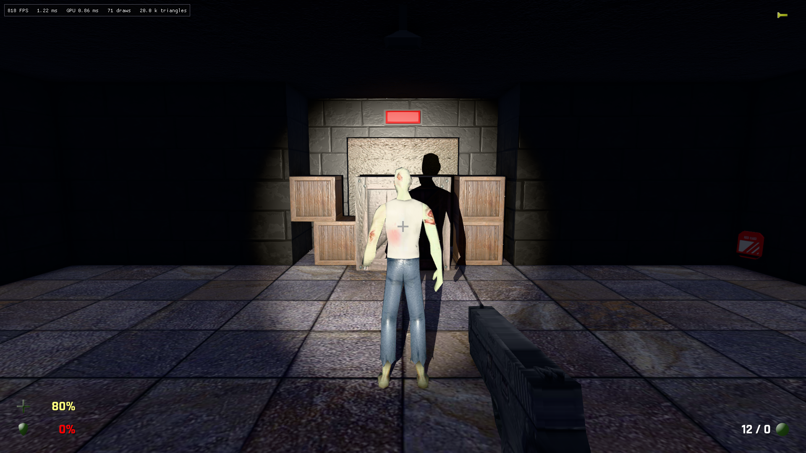
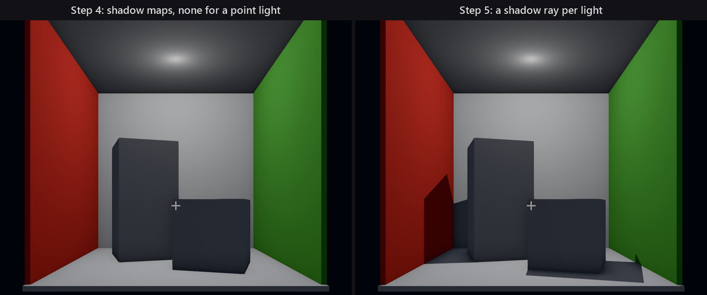

# No more shadow maps

Until now, shadows came from shadow maps: each frame, the four spotlights nearest the camera rendered the scene from their own point of view into a texture, and every pixel checked that texture to know whether it was hidden from the light. Every other light had no shadow at all and shone straight through walls. Step 5 of the ray tracing phase replaces all of that with one question per pixel and per light: is there anything between me and the light? A ray answers it.

[TO WRITE: shadows in the original Daidalos, or the shadow map bugs I remember fighting.]

## Every light, every time

I had a choice to make here. The original level marks some of its lamps "no shadow" [TO WRITE: why, back then]. I decided every light casts shadows, always: no flag, no budget, no setting. The two shadow settings of the configuration file are gone too.

What a shadow ray sees is what you'd expect. Walls and objects block it. Grids and other cut-out surfaces let light through their holes. The weapon in your hand doesn't count, or it would throw a giant shadow over the level. Animated characters cast shadows from their real pose, because since step 3 the rays and the renderer use the very same animated mesh.

*The flashlight's shadow, now traced, at the end of step 5.*

## Checked against the reference

This is the first step that can be checked against the path tracer from the last post. The renderer draws the Cornell box with direct light only, and the path tracer does the same with a single bounce. Then a tool called FLIP, published by NVIDIA, compares the two the way a person would, from 0 (identical) to 1 (nothing alike).

*The Cornell box in the normal renderer, before and after this step. Shadow maps only served spotlights, so its point light cast no shadow at all.*

The first score was 0.108, which worried me. The shadows matched; the edges didn't. The path tracer was smoothing every edge by averaging many points per pixel, while the renderer looks at each pixel's center only. Telling the path tracer to look at pixel centers too, for this comparison, brought it down to **0.014**. To check the test can actually tell, the path tracer also renders the box with all shadows switched off: that scores 0.113 against the renderer, eight times worse. The test now fails if the two drift apart.

## The numbers

| | |
|---|---|
| Mesh pass, with a ray per light | 0.008 to 0.015 ms more |
| Shadow map pass | gone (it took 0.044 ms) |
| Whole frame | about 0.02 ms faster |
| FLIP, renderer vs path tracer, direct light | 0.014 |
| Automated tests | 579 |

At 1280×720 on an RTX 3090. Tracing a ray per light turned out cheaper than drawing the scene four more times.

## What isn't done

- **Shadows are hard-edged.** Real lights have a size, which blurs shadows; that needs random rays and a denoiser, step 8.
- **Smoke and particles** still don't cast or receive shadows. That waits for ray-traced fog, step 13.
- **I didn't score the factory itself against the path tracer yet,** only the Cornell box.
- **Linux is still unverified.**

## Next

Step 6: a sky. The factory's biggest room is open to it, and rays that leave the level must find it.
