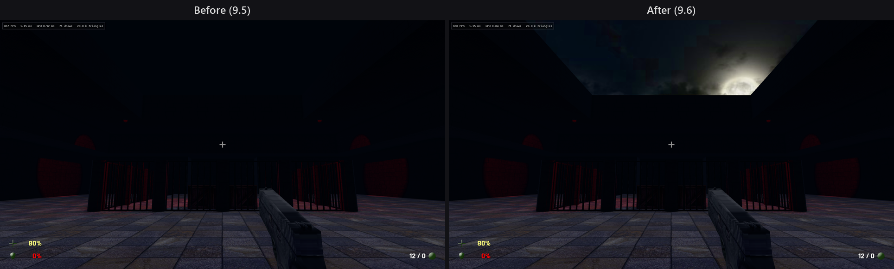
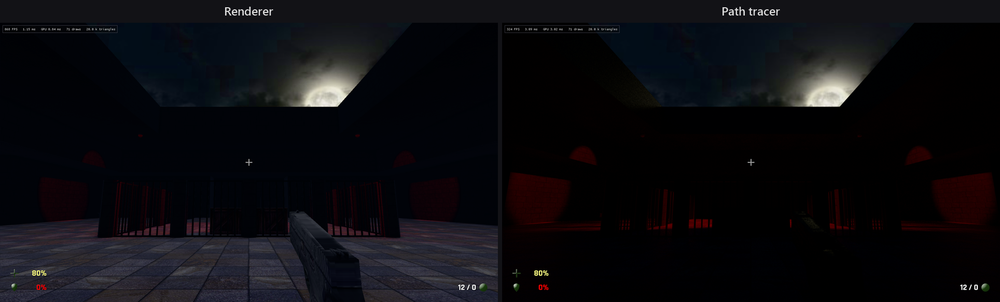

# The sky is back

The factory's biggest room has no roof over part of it. In the original Daidalos you looked up and saw clouds. In the new engine you saw a flat color, the fog's, because nothing in the plan said otherwise. I noticed it was missing and asked for it, so the sky became step 6 of the ray tracing phase, before anything else, and every later step moved down by one.

[TO WRITE: the sky in the original Daidalos, how I made those six images.]

## Six faces of a cube

The original sky is six square images: right, left, up, down, front and back, the faces of a big cube around the camera. The engine can now hold that kind of texture, a "cube texture", and look it up by direction: which way am I looking? Here is the color.

There was one trap. The old engine measured "front" the other way round from the new one. Rather than repaint my own images, the shader flips one axis when it looks the sky up. A test draws a sky with a different color on each face and checks that you see the right one where you look.

## Drawn where nothing is

The sky is drawn last, behind everything, only on the pixels that nothing else covered. Indoors, that's none, and it costs almost nothing.

*The open hall, before and after this step, from the same spot.*

## Rays find it too

This is the part that matters for what comes next. Since step 4, the path tracer follows light as it bounces, and some rays leave the level through the opening. Until now they found a plain color. Now they find the sky, through the very same lookup as the screen. So the sky lights the room in the reference image, and the steps to come, bounced light and reflections, will see the same sky.

*The same view in the renderer and in the path tracer. The sky is in both; the path-traced factory is still very dark, as the last two posts said.*

The level-loading script reads the sky's name from the original level and copies its six images, so nothing was placed by hand.

## What isn't done

- **The sky looks darker than in the original.** It's an evening sky, and the new engine's tonemapping darkens it further. The engine can make it brighter; I haven't decided how bright it should be.
- **The sky doesn't light the normal view yet,** only the path tracer. The flat ambient light still does that job until bounced light arrives, step 9.
- **Linux is still unverified.**

## Next

Step 7: motion vectors and temporal antialiasing, which every later step needs to blend frames together.
